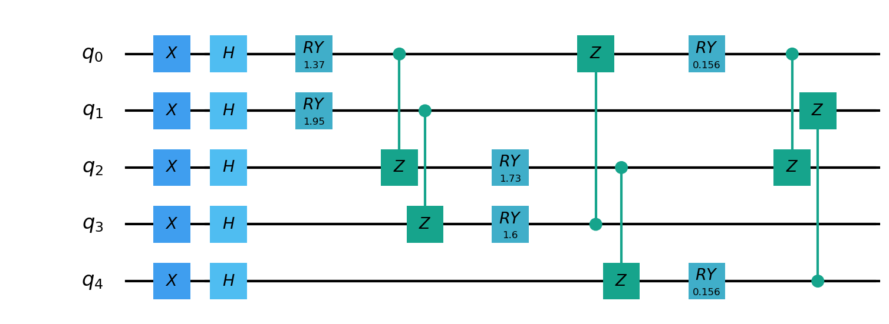
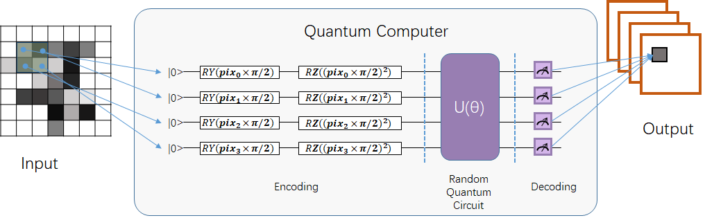
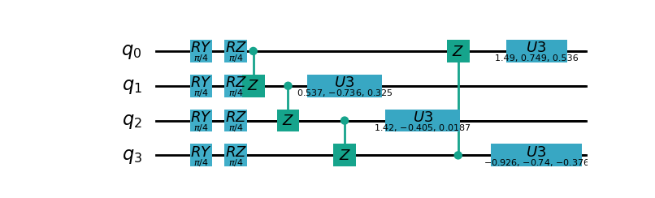
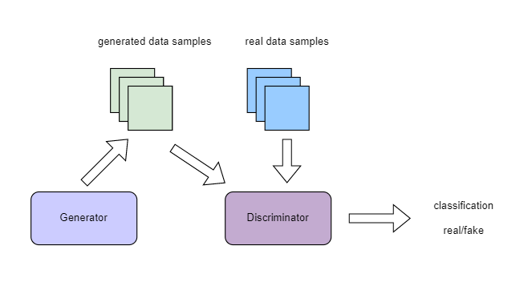
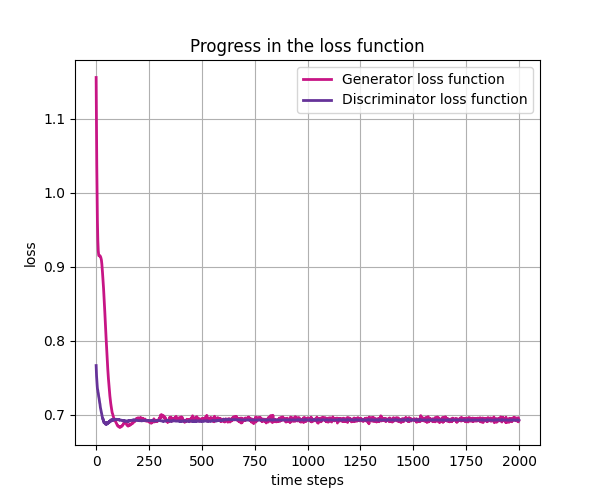
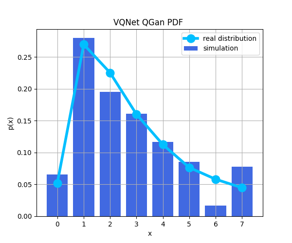
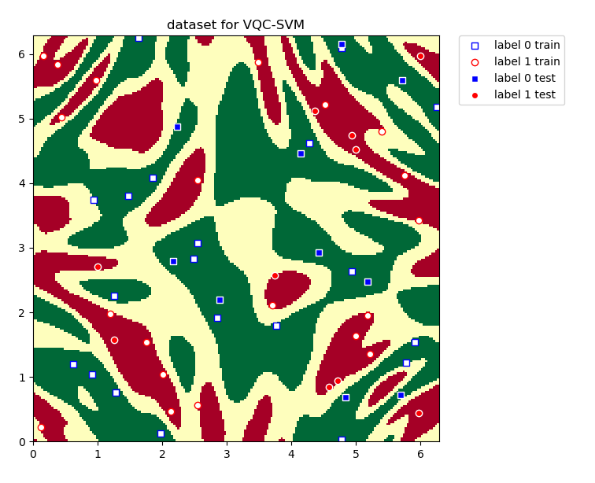
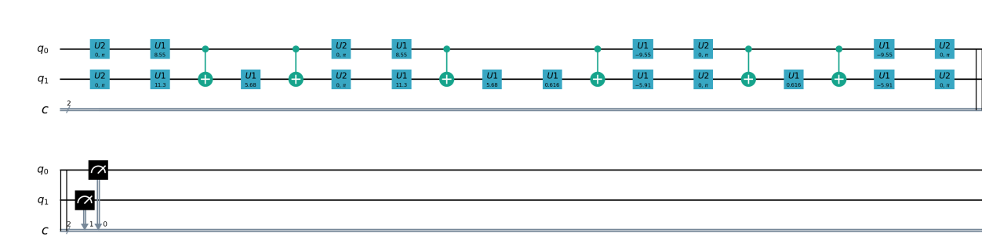

.. _use_pyqpanda3_quantum_machine_learning_module:

Use the pyqpanda3 quantum machine learning module
#################################################

.. warning::

    The quantum computing part of the following interfaces uses pyqpanda3 https://qcloud.originqc.com.cn/document/qpanda-3/index.html.

Quantum computing layer
***********************************

.. _QuantumLayer_pq3:

QuantumLayer
============================

If you are familiar with pyqpanda3 syntax, you can use the QuantumLayer interface to customize the pyqpanda3 simulator for computation.

.. py:class:: pyvqnet.qnn.pq3.quantumlayer.QuantumLayer(qprog_with_measure,para_num,diff_method:str = "parameter_shift",delta:float = 0.01,dtype=None,name="")

	Abstract computation module for a variational quantum layer. It simulates a parameterized quantum circuit with pyqpanda3 and returns measurement results. The layer inherits the gradient computation module of the VQNet framework; it can compute circuit parameter gradients with the parameter-shift method and other methods, train variational quantum circuit models, or embed variational quantum circuits into hybrid quantum-classical models.

    :param qprog_with_measure: quantum circuit run and measurement function built with pyqpanda3.
    :param para_num: `int` - number of parameters.
    :param diff_method: method for computing quantum circuit parameter gradients, "parameter_shift" or "finite_diff", default "parameter_shift".
    :param delta: \delta used in finite-difference gradient computation.
    :param dtype: parameter data type, default: None, which uses the default data type kfloat32, a 32-bit floating point number.
    :param name: module name, default "".

    :return: a module that can compute quantum circuits.

    .. note::
        qprog_with_measure is a quantum circuit function defined in pyQPanda: https://qcloud.originqc.com.cn/document/qpanda-3/dc/d12/tutorial_quantum_program.html.

        The function must take two arguments, input and param (even if one is not actually used), and return the circuit measurement results or expectation values (as np.ndarray or a list containing numeric values); otherwise it cannot run correctly in QuantumLayer.

        See the example below for how to use the quantum circuit function qprog_with_measure.

        qprog_with_measure(input,param)

            `input`: one-dimensional classical data as input. If there is none, pass None.

            `param`: one-dimensional trainable parameters of the variational quantum circuit as input.

    .. note::

        This class has the aliases `QuantumLayerV2` and `QpandaQCircuitVQCLayerLite`.

    .. note::

        When computing gradients, this class requires pyqpanda3 additionally; its computational cost scales linearly with the product of the number of circuit evaluations, parameters, data points, and data dimensions.

    Example::

        from pyvqnet.qnn.pq3.measure import ProbsMeasure
        from pyvqnet.qnn.pq3.quantumlayer import QuantumLayer
        from pyvqnet.tensor import QTensor,ones
        import pyqpanda3.core as pq
        def pqctest (input,param):
            num_of_qubits = 4

            m_machine = pq.CPUQVM()

            qubits = range(num_of_qubits)

            circuit = pq.QCircuit()
            circuit<<pq.H(qubits[0])
            circuit<<pq.H(qubits[1])
            circuit<<pq.H(qubits[2])
            circuit<<pq.H(qubits[3])

            circuit<<pq.RZ(qubits[0],input[0])
            circuit<<pq.RZ(qubits[1],input[1])
            circuit<<pq.RZ(qubits[2],input[2])
            circuit<<pq.RZ(qubits[3],input[3])

            circuit<<pq.CNOT(qubits[0],qubits[1])
            circuit<<pq.RZ(qubits[1],param[0])
            circuit<<pq.CNOT(qubits[0],qubits[1])

            circuit<<pq.CNOT(qubits[1],qubits[2])
            circuit<<pq.RZ(qubits[2],param[1])
            circuit<<pq.CNOT(qubits[1],qubits[2])

            circuit<<pq.CNOT(qubits[2],qubits[3])
            circuit<<pq.RZ(qubits[3],param[2])
            circuit<<pq.CNOT(qubits[2],qubits[3])

            prog = pq.QProg()
            prog<<circuit

            rlt_prob = ProbsMeasure(m_machine,prog,[0,2])
            return rlt_prob
        pqc = QuantumLayer(pqctest,3)

        #classic data as input
        input = QTensor([[1,2,3,4],[4,2,2,3],[3.0,3,2,2]] )

        #forward circuits
        rlt = pqc(input)

        print(rlt)

        grad = ones(rlt.data.shape)*1000
        #backward circuits
        rlt.backward(grad)

        print(pqc.m_para.grad)

QpandaQProgVQCLayer
============================

.. py:class:: pyvqnet.qnn.pq3.quantumlayer.QpandaQProgVQCLayer(origin_qprog_func,para_num,qvm_type="cpu", pauli_str_dict=None, shots=1000, initializer=None,dtype=None,name="")

    It submits a parameterized quantum circuit to the local QPanda3 full-amplitude simulator for computation and trains the circuit parameters.
    It supports batch data and uses the parameter-shift rule to estimate parameter gradients.
    For CRX, CRY, and CRZ, this layer uses the formulas in https://iopscience.iop.org/article/10.1088/1367-2630/ac2cb3 ; other gates use the default parameter-shift method.

    :param origin_qprog_func: callable quantum circuit function built with QPanda.
    :param para_num: `int` - number of parameters; parameters are one-dimensional.
    :param qvm_type: `str` - pyqpanda3 simulator type, `cpu` or `gpu`, default `cpu` .
    :param pauli_str_dict: `dict|list` - dictionary or list of dictionaries of Pauli operators in the quantum circuit. Default None.
    :param shots: `int` - number of measurement shots. Default 1000.
    :param initializer: initializer for parameter values. Default None.
    :param dtype: parameter data type. Default None, which uses the default data type.
    :param name: module name. Default empty string.

    :return: returns a QuantumLayerV3 class

    .. note::

        origin_qprog_func is a quantum circuit function defined by the user with pyqpanda3:
        https://qcloud.originqc.com.cn/document/qpanda-3/dc/d12/tutorial_quantum_program.html .

        The function must take two arguments, input and param (even if one is not actually used), and return pyqpanda3.core.QProg data; otherwise it cannot run correctly in QuantumLayerV3.

        origin_qprog_func (input,param)

        `input`: one-dimensional classical data as a user-defined array-like input

        `param`: array_like, one-dimensional quantum circuit parameters as user-defined input

    .. note::

        This class has the alias `QuantumLayerV3` .

    .. note::

        Computing gradients with this class additionally requires pyqpanda3, and the cost scales linearly with the product of the number of circuit evaluations, parameters, data points, and data dimensions.

    Example::

        import pyqpanda3.core as pq
        import pyvqnet
        from pyvqnet.qnn.pq3.quantumlayer import  QpandaQProgVQCLayer

        def qfun(input, param ):
            m_qlist = range(3)
            cbits = range(3)
            measure_qubits = [0,1, 2]
            m_prog = pq.QProg()
            cir = pq.QCircuit(3)

            cir<<pq.RZ(m_qlist[0], input[0])
            cir<<pq.RX(m_qlist[2], input[2])
            qcir = pq.RX(m_qlist[1], param[1]).control(m_qlist[0])
            cir<<qcir
            qcir = pq.RY(m_qlist[0], param[2]).control(m_qlist[1])
            cir<<qcir
            cir<<pq.RY(m_qlist[0], input[1])
            qcir = pq.RZ(m_qlist[0], param[3]).control(m_qlist[1])
            cir<<qcir
            m_prog<<cir

            for idx, ele in enumerate(measure_qubits):
                m_prog << pq.measure(m_qlist[ele], cbits[idx])  # pylint: disable=expression-not-assigned
            return m_prog

        from pyvqnet.utils.initializer import ones
        l = QpandaQProgVQCLayer(qfun,
                        4,
                        "cpu",
                        pauli_str_dict=None,
                        shots=1000,
                        initializer=ones,
                        name="")
        x = pyvqnet.tensor.QTensor(
            [[2.56, 1.2,-3]],
            requires_grad=True)
        y = l(x)

        y.backward()
        print(l.m_para.grad.to_numpy())
        print(x.grad.to_numpy())

QuantumBatchAsyncQcloudLayer
=================================

When you install the latest version of pyqpanda3, you can use this interface to define a variational circuit and submit it to run on a real OriginQC chip.

.. py:class:: pyvqnet.qnn.pq3.quantumlayer.QuantumBatchAsyncQcloudLayer(origin_qprog_func, qcloud_token, para_num, pauli_str_dict=None, shots = 1000, initializer=None, dtype=None, name="", diff_method="parameter_shift", submit_kwargs={}, query_kwargs={})

    Abstract computation module for the Origin Quantum https://qcloud.originqc.com.cn/ real chip using pyqpanda3 QCloud. It submits parameterized quantum circuits to real chips and obtains measurement results.
    If diff_method == "random_coordinate_descent", the layer randomly selects a single parameter to compute the gradient and leaves the other parameters at zero. Reference: https://arxiv.org/abs/2311.00088

    .. note::

        qcloud_token is the API token you apply for at https://qcloud.originqc.com.cn/ .
        origin_qprog_func must return pyqpanda3.core.QProg data. If the measurement observable pauli_str_dict is not set, the QProg must already contain a measure.
        origin_qprog_func must have the following form:

        origin_qprog_func(input,param)

            `input`: input 1D or 2D classical data; for 2D, the first dimension is the batch size

            `param`: one-dimensional trainable parameters of the variational quantum circuit as input

    .. note::

        Computing gradients with this class additionally requires a chip, and the cost scales linearly with the product of the number of circuit evaluations, parameters, data points, and data dimensions.

    .. note::

        In the current version, the default total timeout for a single circuit submission to QCloud is 60 seconds. If QCloud is busy and the request times out, you can set the `total_timeout` key in ``query_kwargs`` to specify the number of seconds to wait.

    :param origin_qprog_func: variational quantum circuit function built with QPanda; it must return a QProg.
    :param qcloud_token: `str` - type of quantum machine or cloud token used for execution.
    :param para_num: `int` - number of parameters; parameters are a QTensor of size [para_num].
    :param pauli_str_dict: `dict|list` - dictionary or list of dictionaries of Pauli operators in the quantum circuit. Default "none", which performs a measurement operation; if a dictionary of Pauli operators is given, single or multiple expectation values are computed.
    :param shots: `int` - number of measurements. Default 1000.
    :param initializer: initializer for parameter values. Default "none", which uses a normal distribution over 0~2*pi.
    :param dtype: parameter data type. Default None, which uses the default data type pyvqnet.kfloat32.
    :param name: module name. Default empty string.
    :param diff_method: differentiation method for gradient computation. Default "parameter_shift", "random_coordinate_descent".
    :param submit_kwargs: additional keyword arguments for submitting quantum circuits, default: {"if_print_qcloud_log":False,"chip_id":"WK_C180","is_amend":True,"is_mapping":True,"is_optimization":True,"compile_level":3,"default_task_group_size":200,"test_qcloud_fake":False,"server_ip_address":"","use_qwc":True}; when test_qcloud_fake is True, simulate locally with CPUQVM.
    :param query_kwargs: additional keyword arguments for querying quantum results, default: {"timeout":1,"total_timeout":60, "print_query_info":True,"sub_circuits_split_size":1}.
    :return: a module that can compute quantum circuits.

    Example::

        import pyqpanda3.core as pq
        import pyvqnet
        from pyvqnet.qnn.pq3.quantumlayer import QuantumBatchAsyncQcloudLayer

        def qfun(input,param):
            measure_qubits = [0,2]
            m_qlist = range(6)
            cir = pq.QCircuit(6)
            cir << (pq.RZ(m_qlist[0],input[0]))
            cir << pq.CNOT(m_qlist[0],m_qlist[1])
            cir << pq.RY(m_qlist[1],param[0])
            cir << pq.CNOT(m_qlist[0],m_qlist[2])
            cir << pq.RZ(m_qlist[1],input[1])
            cir << pq.RY(m_qlist[2],param[1])
            cir << pq.H(m_qlist[2])
            m_prog = pq.QProg(cir)

            for idx, ele in enumerate(measure_qubits):
                m_prog << pq.measure(m_qlist[ele], m_qlist[idx])  # pylint: disable=expression-not-assigned
            return m_prog

        l = QuantumBatchAsyncQcloudLayer(qfun,
                        "your_api_token",
                        2,

                        pauli_str_dict=None,
                        shots = 1000,
                        initializer=None,
                        dtype=None,
                        name="",
                        diff_method="parameter_shift",
                        submit_kwargs={"test_qcloud_fake":True},
                        query_kwargs={})
        x = pyvqnet.tensor.QTensor([[0.56,1.2],[0.56,1.2],[0.56,1.2],[0.56,1.2],[0.56,1.2]],requires_grad= True)
        y = l(x)
        print(y)
        y.backward()
        print(l.m_para.grad)
        print(x.grad)

        def qfun2(input,param ):

            m_qlist = range(6)
            cir = pq.QCircuit(6)
            cir<<pq.RZ(m_qlist[0],input[0])
            cir<<pq.CNOT(m_qlist[0],m_qlist[1])
            cir<<pq.RY(m_qlist[1],param[0])
            cir<<pq.CNOT(m_qlist[0],m_qlist[2])
            cir<<pq.RZ(m_qlist[1],input[1])
            cir<<pq.RY(m_qlist[2],param[1])
            cir<<pq.H(m_qlist[2])
            m_prog = pq.QProg(cir)

            return m_prog
        l = QuantumBatchAsyncQcloudLayer(qfun2,
                "your_api_token",
                2,

                pauli_str_dict={'Z0 X1':10,'':-0.5,'Y2':-0.543,"":3333},
                shots = 1000,
                initializer=None,
                dtype=None,
                name="",
                diff_method="parameter_shift",
                submit_kwargs={"test_qcloud_fake":True},
                query_kwargs={})
        x = pyvqnet.tensor.QTensor([[0.56,1.2],[0.56,1.2],[0.56,1.2],[0.56,1.2]],requires_grad= True)
        y = l(x)
        print(y)
        y.backward()
        print(l.m_para.grad)
        print(x.grad)

QuantumLayerAdjoint
============================

.. py:class:: pyvqnet.qnn.pq3.quantumlayer.QuantumLayerAdjoint(pq3_vqc_circuit,param_num,pauli_dicts,dtype = None,name="")

    This class uses the VQCircuit interface of pyqpanda3 https://qcloud.originqc.com.cn/document/qpanda-3/d8/d94/tutorial_variational_quantum_circuit.html to compute gradients of circuit parameters with respect to the Hamiltonian through the adjoint method.

    The class supports batch input and multiple Hamiltonian outputs.

    .. note::

        When using this interface, you must build the circuit with gates under VQCircuit.

        Only a limited set of gates is supported; unsupported gates raise an exception.

        The input parameter ``pq3_vqc_circuit`` can contain only two parameters, `x` and `param`, and they must be one-dimensional arrays or lists.

        In the ``pq3_vqc_circuit`` function, you must use ``pyqpanda3.vqcircuit.VQCircuit().set_Param`` to define how inputs and parameters are handled.

        You also need to provide the number of parameters in ``param_num`` in advance. This interface initializes a parameter ``m_para`` with length ``param_num``.

        See the example below.

    :param pq3_vqc_circuit: custom pyqpanda3 VQCircuit circuit.
    :param param_num: number of parameters.
    :param pauli_dicts: expected observables, which can be a list.
    :param dtype: parameter type, kfloat32 or kfloat64, default: None, which uses kfloat32.
    :param name: name of this interface.
    :return: returns a QuantumLayerAdjoint instance

    Example::

        from pyvqnet.qnn.pq3 import QuantumLayerAdjoint
        from pyvqnet import tensor

        from pyqpanda3.vqcircuit import VQCircuit
        import pyqpanda3 as pq3

        l = 3
        n = 7
        def pqctest(x,param):
            vqc = VQCircuit()
            vqc.set_Param([len(param) +len(x)])
            w_offset = len(x)
            for j in range(len(x)):
                vqc << pq3.core.RX(j, vqc.Param([j  ]))
            for j in range(l):
                for i in range(n - 1):
                    vqc << pq3.core.CNOT(i, i + 1)
                for i in range(n):
                    vqc << pq3.core.RX(i, vqc.Param([w_offset + 3 * n * j + i]))

                    vqc << pq3.core.RZ(i, vqc.Param([w_offset + 3 * n * j + i + n]))
                    vqc << pq3.core.RY(i, vqc.Param([w_offset + 3 * n * j + i + 2 * n]))

            return vqc

        Xn_string = ' '.join([f'X{i}' for i in range(n)])
        pauli_dict  = {Xn_string:1.}

        layer = QuantumLayerAdjoint(pqctest,3*l*n,pauli_dict)

        x = tensor.randn([2,5])
        x.requires_grad = True
        y = layer(x)
        y.backward()
        print(layer.m_para.grad)
        print(x.grad)

        Xn_string = ' '.join([f'X{i}' for i in range(n)])
        Zn_string = ' '.join([f'Z{i}' for i in range(n)])
        pauli_dict  = {Xn_string:1.,Zn_string:0.5}

        layer = QuantumLayerAdjoint(pqctest,3*l*n,pauli_dict)

        x = tensor.randn([2,5])
        x.requires_grad = True
        y = layer(x)
        y.backward()
        print(layer.m_para.grad)
        print(x.grad)

        Xn_string = ' '.join([f'X{i}' for i in range(n)])
        Zn_string = ' '.join([f'Z{i}' for i in range(n)])
        pauli_dict  = {Xn_string:1.,Zn_string:0.5}

        layer = QuantumLayerAdjoint(pqctest,3*l*n,pauli_dict)

        x = tensor.randn([1,5])
        x.requires_grad = True
        y = layer(x)
        y.backward()
        print(layer.m_para.grad)
        print(x.grad)

        Xn_string = ' '.join([f'X{i}' for i in range(n)])
        Zn_string = ' '.join([f'Z{i}' for i in range(n)])
        pauli_dict  = [{Xn_string:1.,Zn_string:0.5},{Xn_string:1.,Zn_string:0.5}]

        layer = QuantumLayerAdjoint(pqctest,3*l*n,pauli_dict)

        x = tensor.randn([1,5])
        x.requires_grad = True
        y = layer(x)
        y.backward()
        print(layer.m_para.grad)
        print(x.grad)

        Xn_string = ' '.join([f'X{i}' for i in range(n)])
        Zn_string = ' '.join([f'Z{i}' for i in range(n)])
        pauli_dict  = [{Xn_string:1.,Zn_string:0.5},{Xn_string:1.,Zn_string:0.5}]

        layer = QuantumLayerAdjoint(pqctest,3*l*n,pauli_dict)

        x = tensor.randn([2,5])
        x.requires_grad = True
        y = layer(x)
        y.backward()
        print(layer.m_para.grad)
        print(x.grad)
        """
        [-0.1086438, 0.1805159, 0.2619071,..., 0.1508062, 0.0329617,-0.0043367]
        <QTensor [63] DEV_CPU kfloat32>

        [[-0.0425088, 0.0187212,-0.0326243, 0.1314874,-0.0729216],
        [-0.0972663,-0.0371378,-0.0455299,-0.0170686,-0.0328533]]
        <QTensor [2, 5] DEV_CPU kfloat32>

        [ 0.0706403,-0.1070583, 0.0547093,...,-0.0183769,-0.0742296, 0.0026942]
        <QTensor [63] DEV_CPU kfloat32>

        [[-0.07577  ,-0.1364278, 0.0220043, 0.0690343, 0.0281384],
        [ 0.0075356,-0.1627405,-0.0381604, 0.1185545, 0.1409108]]
        <QTensor [2, 5] DEV_CPU kfloat32>

        [-0.0634308,-0.0128268, 0.0396237,...,-0.0350691,-0.116307 , 0.0164972]
        <QTensor [63] DEV_CPU kfloat32>

        [[-0.0823639,-0.0418629, 0.0105356, 0.0699336, 0.041226 ]]
        <QTensor [1, 5] DEV_CPU kfloat32>

        [-0.1281752, 0.0852512, 0.0678721,...,-0.080481 , 0.0202518,-0.0348869]
        <QTensor [63] DEV_CPU kfloat32>

        [[-0.0339751,-0.0330053,-0.0651799, 0.2171837,-0.1267595]]
        <QTensor [1, 5] DEV_CPU kfloat32>

        [ 0.305574 , 0.2730191, 0.0605986,...,-0.2138517,-0.2475468, 0.174026 ]
        <QTensor [63] DEV_CPU kfloat32>

        [[ 0.1867954,-0.0704528,-0.0603823,-0.0123921,-0.0938597],
        [-0.041001 ,-0.2520995, 0.0683114,-0.0986969, 0.1000023]]
        <QTensor [2, 5] DEV_CPU kfloat32>
        """

VQCQCloudLayer
============================

.. py:class:: pyvqnet.qnn.pq3.vqc_qcloud_layer.VQCQCloudLayer(vqc_module, qcloud_token, pauli_str_dict=None, shots=1000, name="", submit_kwargs={}, query_kwargs={})

    Submit a VQC Module to a real QCloud chip or the pyqpanda3 local simulator for execution.

    Forward pass: does not run VQNet's variational quantum circuit computation; instead it calls a real quantum chip or the local qpanda simulator.

    Backward pass: computes gradients with the parameter_shift rule. For each input dimension and each trainable parameter in the VQC,
    it generates circuits with +/- pi/2 offsets and submits them, then computes the Jacobian from the results. Gradients are set on the input tensor and the trainable Parameters of the VQC.

    .. note::

        The default total timeout for a single circuit submission to QCloud is 60 seconds. If QCloud is busy and the request times out, set the ``total_timeout`` key in ``query_kwargs`` to specify the number of seconds to wait.

    .. note::

        A measurement function (such as ``MeasureAll``) cannot be defined in ``vqc_module``; measurement is specified through the observable in the ``pauli_str_dict`` parameter.
        For example: ``VQCQCloudLayer(vqc_module, token, pauli_str_dict={'Z0': 1, 'Z1': 1})``.

    :param vqc_module: VQNet VQC Module; it must contain a QMachine with save_ir=True.
    :param qcloud_token: QCloud API token. Pass an empty string when using the local simulator.
    :param pauli_str_dict: dictionary of Pauli operators used for expectation value computation. Default None, which performs a measurement operation.
    :param shots: number of measurements. Default 1000.
    :param name: module name. Default empty string.
    :param submit_kwargs: additional keyword arguments for submitting quantum circuits, default: {"if_print_qcloud_log":False,"chip_id":"WK_C180","is_amend":True,"is_mapping":True,"is_optimization":True,"compile_level":3,"default_task_group_size":200,"test_qcloud_fake":False,"server_ip_address":""}; when test_qcloud_fake is True, simulate locally with CPUQVM.
    :param query_kwargs: additional keyword arguments for querying quantum results, default: {"timeout":1,"total_timeout":60, "print_query_info":True,"sub_circuits_split_size":1}.

    Example::

        from pyvqnet.qnn.vqc import *
        from pyvqnet.qnn.pq3 import VQCQCloudLayer
        from pyvqnet.nn import Module
        import pyvqnet

        class QModel(Module):
            def __init__(self, num_wires, dtype):
                super(QModel, self).__init__()
                self._num_wires = num_wires
                self._dtype = dtype
                self.qm = QMachine(num_wires, dtype=dtype, save_ir=True)
                self.rx_layer = RX(trainable=False, wires=0)
                self.u1 = U1(trainable=True, wires=[1])
                self.cnot = CNOT(wires=[0, 1])

            def forward(self, x, *args, **kwargs):
                self.qm.reset_states(x.shape[0])
                self.rx_layer(params=x[:, [0]], q_machine=self.qm)
                self.cnot(q_machine=self.qm)
                self.u1(q_machine=self.qm)
                return x

        qmodel = QModel(num_wires=2, dtype=pyvqnet.kcomplex64)
        layer = VQCQCloudLayer(
            qmodel,
            "your_qcloud_token",
            pauli_str_dict={'Z0': 1, 'Z1': 1},
            shots=1000,
            submit_kwargs={"test_qcloud_fake": True},
        )
        x = pyvqnet.tensor.QTensor([[0.5, 0.3], [0.5, 0.3]], requires_grad=True)
        y = layer(x)
        y.backward()
        print(x.grad)
        print(qmodel.u1.params.grad)

VQCLayer
============================

.. py:class:: pyvqnet.qnn.pq3.vqclayer.VQCLayer(vqc_module, qcloud_token=None, shots=1000, diff_method="parameter_shift", submit_kwargs=None, query_kwargs=None, name="")

    VQCLayer is a unified quantum layer interface. It wraps a VQC Module containing a ``QMachine`` into a trainable quantum layer and selects the execution backend with ``submit_kwargs["backend"]``:

    * ``vqnet_native`` (default): computes gradients entirely locally in VQNet through autograd, with no circuit submission.
    * ``qcloud_fake``: submits to the local pyqpanda3 QVM (FakeBackend) simulator and computes gradients with the parameter-shift method.
    * ``qpanda_runtime``: submits to a real qpanda3_runtime chip.
    * ``qcloud_service``: submits to a real QCloud chip. Setting ``submit_kwargs["test_qcloud_fake"]=True`` runs the same OriginIR path on the local simulator as a dry run, without consuming chip quota.

    The layer manages measurement uniformly; the two measurement modes are mutually exclusive:

    * ``submit_kwargs["pauli_str_dict"]``: expectation value measurement.
    * ``query_kwargs["measure_qubits"]``: probability measurement.

    Classical shadow measurement:

    When ``submit_kwargs["pauli_str_dict"]`` is enabled, you can select a faster expectation value measurement scheme with ``submit_kwargs["shadow_config"]``:

    * ``shadow_config=0`` (default): full measurement (MeasureAll), exact expectation values.
    * ``shadow_config=1``: random classical shadow. shots is the total number of snapshots T, and each snapshot circuit runs 1 shot.
    * ``shadow_config=2``: derandomized classical shadow. shots is the scheduling length N; greedy scheduling generates N circuits, each with 1 shot.

    Classical shadows work on ``vqnet_native`` and the submission backends (``qcloud_fake`` / ``qcloud_service``) but are not supported on ``qpanda_runtime`` (raises ``ValueError``).
    Gradient path: ``vqnet_native`` uses the native automatic differentiation of the VQC module;
    submission backends use the parameter-shift method on mode-0 circuits.

    .. note::

        ``vqc_module`` must contain a ``QMachine`` with ``save_ir=True``; submission backends use it to build OriginIR.
        For example: ``QMachine(num_wires, dtype=dtype, save_ir=True)``.

    .. note::

        Exactly one measurement mode must be specified: ``submit_kwargs["pauli_str_dict"]`` (expectation value)
        and ``query_kwargs["measure_qubits"]`` (probability) are mutually exclusive; specifying both or neither raises ``ValueError``.

    .. note::

        When ``diff_method="random_coordinate_descent"``, the layer randomly selects a single parameter at each backward pass to compute the gradient,
        and leaves the other parameters at zero. Reference: https://arxiv.org/abs/2311.00088

    :param vqc_module: VQC Module containing a ``QMachine`` with ``save_ir=True``.
    :param qcloud_token: ``str|None`` - QCloud token for submission backends (``qcloud_fake`` / ``qcloud_service`` / ``qpanda_runtime``). The ``vqnet_native`` backend ignores this parameter. Default None.
    :param shots: ``int`` - number of measurements. Default 1000.
    :param diff_method: ``str`` - gradient computation method, default ``"parameter_shift"``. The other option is ``"random_coordinate_descent"``.
    :param submit_kwargs: ``dict|None`` - execution and measurement settings, default None (``{}``). Recognized keys:
        ``backend``: execution backend, ``vqnet_native`` default / ``qcloud_fake`` / ``qpanda_runtime`` / ``qcloud_service``;
        ``pauli_str_dict``: expectation value measurement, mutually exclusive with ``query_kwargs["measure_qubits"]``;
        ``shadow_config``: expectation value measurement scheme (requires ``pauli_str_dict``): 0 = full measurement (default), 1 = random classical shadow, 2 = derandomized classical shadow. Supported on ``vqnet_native`` and submission backends, not on ``qpanda_runtime``;
        ``shadow_seed``: classical shadow recipe seed, random by default (fixed for the layer lifetime, so training is reproducible);
        ``noise_model``: ``QCloudNoiseModel`` noise model instance, used by the ``qcloud_fake`` backend to generate noisy local simulation results; the ``qcloud_service`` backend supports only cloud simulator chips (``full_amplitude`` / ``partial_amplitude`` / ``single_amplitude``);
        ``log_file``: log output file path (through ``LogOutput.FILE``), mutually exclusive with ``if_print_qcloud_log``, FILE takes precedence; default empty string (no file output);
        ``point_label``: passed through to the cloud backend submission JSON, default 1;
        ``enable_binary_encoding``: enable binary encoding submission, default False;
        ``if_print_qcloud_log``: whether to print submission logs, default False;
        ``chip_id``: chip ID, default "WK_C180";
        ``set_specified_block``: specified chip blocks, default [];
        ``is_amend``: whether to perform error correction, default True;
        ``is_mapping``: whether to map the circuit, default True;
        ``is_optimization``: whether to optimize the circuit, default True;
        ``default_task_group_size``: task group size, default 200;
        ``test_qcloud_fake``: when True, run on the local simulator; forced to True for the ``qcloud_fake`` backend;
        ``fake_async_delay``: asynchronous delay in seconds for the local simulator, default None;
        ``print_ir``: whether to print OriginIR, default False;
        ``server_ip_address``: QCloud server address, default "";
        ``use_qwc``: whether to use QWC task grouping, default True;
        ``streaming``: whether to enable streaming gradients, default False;
        ``block_b`` / ``block_o`` / ``block_k``: batch/output/core dimensions for block-wise contraction, default 0 (disabled).
    :param query_kwargs: ``dict|None`` - query settings, default None (``{}``). Recognized keys:
        ``measure_qubits``: probability measurement, mutually exclusive with ``submit_kwargs["pauli_str_dict"]``;
        ``total_timeout``: total timeout in seconds, default 60, or 3600 on the local simulator;
        ``timeout``: single query timeout in seconds, default 1, or 0.01 on the local simulator;
        ``print_query_info``: whether to print query information, default False;
        ``sub_circuits_split_size``: sub-circuit split size, default 1.
    :param name: ``str`` - module name. Default "".
    :return: a unified quantum layer that can compute quantum circuits.

    Example::

        import pyvqnet
        from pyvqnet import nn
        from pyvqnet.tensor import QTensor
        from pyvqnet.qnn.vqc import QMachine, RY
        from pyvqnet.qnn.pq3 import VQCLayer

        # Define the VQC module: wire0 applies a trainable RY(w) rotation, wire1 encodes classical data as RY(x).
        class QModel(nn.Module):
            def __init__(self):
                super().__init__()
                self.qm = QMachine(2, save_ir=True)
                self.ry_w = RY(trainable=True, wires=0, init_params=QTensor([[0.4]]))
                self.ry_x = RY(trainable=False, wires=1)

            def forward(self, x):
                self.qm.reset_states(x.shape[0])
                self.ry_w(q_machine=self.qm)
                self.ry_x(params=x[:, [0]], q_machine=self.qm)
                return x

        # Backend 1: vqnet_native (default), expectation value measurement.
        layer = VQCLayer(
            QModel(),
            submit_kwargs={"backend": "vqnet_native", "pauli_str_dict": {"Z0 Z1": 1}},
        )
        x = QTensor([[0.3], [0.7]], requires_grad=True)
        y = layer(x)
        y.backward()
        print(y)          # Expectation value of Z0*Z1, shape (2, 1)
        print(x.grad)     # d<Z0 Z1>/dx

        # Backend 1 probability measurement (mutually exclusive with pauli_str_dict).
        layer = VQCLayer(
            QModel(),
            submit_kwargs={"backend": "vqnet_native"},
            query_kwargs={"measure_qubits": [1]},
        )
        x = QTensor([[0.6]], requires_grad=True)
        y = layer(x)      # Probability vector on wire1, shape (1, 2)
        print(y)

        # Backend 2: qcloud_fake (local pyqpanda3 QVM with parameter-shift gradients, no real chip needed).
        from pyvqnet.utils import set_random_seed

        set_random_seed(42)
        layer = VQCLayer(
            QModel(),
            qcloud_token="your_qcloud_token",
            shots=8000,
            submit_kwargs={
                "backend": "qcloud_fake",
                "test_qcloud_fake": True,
                "pauli_str_dict": {"Z0 Z1": 1},
            },
        )
        x = QTensor([[0.3]], requires_grad=True)
        y = layer(x)
        y.backward()
        print(y)          # Sampled expectation value, shape (1, 1)
        print(layer.vqc_module.ry_w.params.grad)

        # Backend 1: classical shadow measurement (shadow_config=1, random classical shadow).
        # shots=500 means 500 snapshots, with 1 shot per snapshot.
        layer = VQCLayer(
            QModel(), shots=500,
            submit_kwargs={
                "backend": "vqnet_native",
                "pauli_str_dict": {"Z0 Z1": 1},
                "shadow_config": 1,
                "shadow_seed": 42,
            },
        )
        x = QTensor([[0.3], [0.7]], requires_grad=True)
        y = layer(x)
        y.backward()
        print(x.grad)

        # Backend 1: derandomized classical shadow (shadow_config=2).
        layer = VQCLayer(
            QModel(), shots=500,
            submit_kwargs={
                "backend": "vqnet_native",
                "pauli_str_dict": {"Z0 Z1": 1},
                "shadow_config": 2,
                "shadow_seed": 42,
            },
        )
        y = layer(QTensor([[0.3], [0.7]], requires_grad=True))
        print(y)

QiskitLayer
=================================

.. py:class:: pyvqnet.qnn.utils.QiskitLayer(qiskit_circuits,para_num)

    A qiskit circuit wrapper layer for forward and backward propagation in VQNet. QISKIT_VQC is a class that defines a qiskit quantum circuit and its `run` function.
    The example below shows how it works. This layer supports only circuit inputs and weights as parameters.

    :param qiskit_circuits: class that defines the qiskit circuit definition, backend, and run function.
    :param para_num: `int` - number of para_num.
    :return: a class that can run a qiskit quantum circuit model.

    Example::

        """
        Train with qiskit

        qiskit                        2.1.1
        qiskit-aer                    0.17.2
        opencv-python
        """
        import sys
        sys.path.insert(0,"../")
        import os
        import os.path
        import urllib
        import gzip
        import numpy as np
        import random
        import sys
        sys.path.insert(0,"../../")
        random.seed(42)
        np.random.seed(42)
        from pyvqnet.nn.module import Module
        from pyvqnet.optim import Adam
        import pyvqnet
        pyvqnet.utils.set_random_seed(42)
        from pyvqnet.nn.loss import MeanSquaredError
        from pyvqnet.qnn.utils import QiskitLayer

        import qiskit
        from qiskit.quantum_info import Statevector
        from qiskit import  QuantumRegister, ClassicalRegister

        from qiskit.quantum_info.operators import  Pauli
        max_parallel_threads = 24
        gpu = False
        method = "statevector"
        backend_options = {
            "method": method,
            "precision": "double",
            "max_parallel_threads": max_parallel_threads,
            "fusion_enable": True,
            "fusion_threshold": 14,
            "fusion_max_qubit": 5,
        }
        from qiskit_aer import StatevectorSimulator
        simulator = StatevectorSimulator()

        simulator.set_options(**backend_options)

        url_base = 'https://ossci-datasets.s3.amazonaws.com/mnist/'
        key_file = {
            'train_img':'train-images-idx3-ubyte.gz',
            'train_label':'train-labels-idx1-ubyte.gz',
            'test_img':'t10k-images-idx3-ubyte.gz',
            'test_label':'t10k-labels-idx1-ubyte.gz'
        }

        def _download(dataset_dir,file_name):
            file_path = dataset_dir + "/" + file_name

            if os.path.exists(file_path):
                with gzip.GzipFile(file_path) as f:
                    file_path_ungz = file_path[:-3].replace('\\', '/')
                    if not os.path.exists(file_path_ungz):
                        open(file_path_ungz,"wb").write(f.read())
                return

            print("Downloading " + file_name + " ... ")
            urllib.request.urlretrieve(url_base + file_name, file_path)
            if os.path.exists(file_path):
                    with gzip.GzipFile(file_path) as f:
                        file_path_ungz = file_path[:-3].replace('\\', '/')
                        file_path_ungz = file_path_ungz.replace('-idx', '.idx')
                        if not os.path.exists(file_path_ungz):
                            open(file_path_ungz,"wb").write(f.read())
            print("Done")

        def download_mnist(dataset_dir):
            for v in key_file.values():
                _download(dataset_dir,v)

        def dataloader(data,label,batch_size, shuffle = True)->np:
            if shuffle:
                for _ in range(len(data)//batch_size):
                    random_index = np.random.randint(0, len(data), (batch_size, 1))
                    yield data[random_index].reshape(batch_size,-1),label[random_index].reshape(batch_size,-1)
            else:
                for i in range(0,len(data)-batch_size+1,batch_size):
                    yield data[i:i+batch_size], label[i:i+batch_size]

        def get_accuracy(result,label):
            result,label = np.array(result.data), np.array(label.data)

            is_correct = (np.abs(result - label) < 0.5)
            is_correct = np.count_nonzero(is_correct)
            acc = is_correct

            return acc

        def load_mnist_4_4(dataset="training_data", digits=np.arange(10),
                        path="."):
            import os, struct
            from array import array as pyarray
            download_mnist(path)
            if dataset == "training_data":
                fname_image = os.path.join(path, 'train-images.idx3-ubyte').replace('\\', '/')
                fname_label = os.path.join(path, 'train-labels.idx1-ubyte').replace('\\', '/')
            elif dataset == "testing_data":
                fname_image = os.path.join(path, 't10k-images.idx3-ubyte').replace('\\', '/')
                fname_label = os.path.join(path, 't10k-labels.idx1-ubyte').replace('\\', '/')
            else:
                raise ValueError("dataset must be 'training_data' or 'testing_data'")

            flbl = open(fname_label, 'rb')
            magic_nr, size = struct.unpack(">II", flbl.read(8))

            lbl = pyarray("b", flbl.read())
            flbl.close()

            fimg = open(fname_image, 'rb')
            magic_nr, size, rows, cols = struct.unpack(">IIII", fimg.read(16))
            img = pyarray("B", fimg.read())
            fimg.close()

            ind = [k for k in range(size) if lbl[k] in digits]
            N = len(ind)
            images = np.zeros((N, rows, cols))
            images_new = []# = np.zeros((N, 4, 4))
            labels = np.zeros((N, 1), dtype=int)
            import cv2
            for i in range(len(ind)):
                tmp1 = np.array(img[ind[i] * rows * cols: (ind[i] + 1) * rows * cols]).reshape((rows, cols))
                tmp1 = tmp1[4:24,4:24]
                tmp = cv2.resize(tmp1,(4,4)).astype(np.float64)

                if np.max(tmp) ==0:
                    continue
                images_new.append(tmp)
                if lbl[ind[i]] ==digits[1]:
                    labels[i] = 1
                else:
                    labels[i] = 0

            return np.array(images_new), labels

        class QISKIT_VQC:

            def __init__(self, n_qubits, backend, shots):
                # --- Circuit definition ---

                qc = ClassicalRegister(1)
                self.qc = qc
                self.n_qubits = n_qubits

                all_qubits = [i for i in range(n_qubits)]
                self.all_qubits= all_qubits

                self.backend = backend
                self.shots = shots

            def run(self,**kwargs):

                x  = kwargs['x']
                weights  = kwargs['w']

                weights = weights.astype(np.float64)
                x = x.astype(np.float64)

                sum_feature = np.power(np.sum([t**2 for t in x]),0.5)
                normalize_feat = x/sum_feature

                self._circuit = qiskit.QuantumCircuit(QuantumRegister(4))

                self.theta = weights.reshape([4,6])
                self._circuit.initialize(normalize_feat, [0,1,2,3])

                # First build the generalized rotation layers
                for i in range(self.n_qubits):
                    self._circuit.rz(self.theta[i,0], i)
                    self._circuit.ry(self.theta[i,1], i)
                    self._circuit.rz(self.theta[i,2], i)

                for d in range(3, 6):
                    # Build the entanglement layer
                    for i in range(self.n_qubits-1):
                        self._circuit.cx(i, i + 1)
                    self._circuit.cx(self.n_qubits-1, 0)
                    # Add an Ry gate to each qubit
                    for i in range(self.n_qubits):
                        self._circuit.ry(self.theta[i,d], i)

                statevec = Statevector(self._circuit)
                Expectation = np.real(statevec.expectation_value(Pauli('ZIII')))
                return Expectation

        #define qiskit circuits class
        circuit = QISKIT_VQC(4, simulator, 1000)

        class Model_qiskit(Module):
            def __init__(self):
                super(Model_qiskit, self).__init__()
                self.qvc = QiskitLayer(circuit,24)

            def forward(self, x):

                return self.qvc(x)*0.5 + 0.5

        def Run_qiskit():

            x_train, y_train = load_mnist_4_4("training_data",digits=[3,6])

            y_train = y_train.reshape(-1, 1)

            x_test, y_test = load_mnist_4_4("testing_data",digits=[3,6])

            x_train = x_train.astype(np.float32)
            x_test = x_test.astype(np.float32)
            y_train = y_train.astype(np.float32)
            y_test = y_test.astype(np.float32)
            x_train = x_train *np.pi / 255
            x_test = x_test *np.pi / 255
            x_train = x_train[:100]
            y_train = y_train[:100]

            x_test = x_test[:50]
            y_test = y_test[:50]

            model = Model_qiskit()

            optimizer = Adam(model.parameters(),lr =0.01)
            batch_size = 10
            epoch = 2

            loss = MeanSquaredError()
            print("start training..............")
            model.train()

            TL=[]

            TA=[]

            for i in range(epoch):
                count=0
                sum_loss = 0
                accuary = 0
                t = 0
                model.train()
                for data,label in dataloader(x_train,y_train,batch_size,True):

                    optimizer.zero_grad()

                    result = model(data)

                    loss_b = loss(label,result)

                    loss_b.backward()
                    optimizer._step()
                    sum_loss += loss_b.item()
                    count+=batch_size
                    accuary += get_accuracy(result,label)
                    t = t + 1

                    print(f"epoch:{i}, iter{t} #### loss:{sum_loss*batch_size/count} #####accuracy:{accuary/count}")
                TL.append(sum_loss*batch_size/count)
                TA.append(accuary/count)
            print(f"qiskit epoch {epoch}, final accuracy {TA[-1]}")

        if __name__=="__main__":

            Run_qiskit()

CirqLayer
=================================

.. py:class:: pyvqnet.qnn.utils.CirqLayer(cirq_vqc,para_num)

    A cirq circuit wrapper layer for forward and backward propagation in VQNet. CIRQ_VQC is a class in which the user defines a cirq quantum circuit and its `run` function. The example below shows how it works.
    This layer supports only circuit inputs and weights as parameters.

    :param cirq_vqc: class that defines the cirq circuit definition, backend, and run function.
    :param para_num: `int` - number of para_num.
    :return: a class that can run a cirq quantum circuit model.

    .. note::

        The example code below requires ``cirq==1.5.0, numpy <2``.

    Example::

        import numpy as np
        import random
        random.seed(42)
        np.random.seed(42)
        from pyvqnet.nn.module import Module
        import pyvqnet
        pyvqnet.utils.set_random_seed(42)
        from pyvqnet.optim import Adam

        from pyvqnet.nn.loss import MeanSquaredError
        from pyvqnet.qnn.utils import CirqLayer

        import cirq
        import sympy
        from pyvqnet.utils.utils import get_circuit_symbols

        def dataloader(data,label,batch_size, shuffle = True)->np:
            if shuffle:
                for _ in range(len(data)//batch_size):
                    random_index = np.random.randint(0, len(data), (batch_size, 1))
                    yield data[random_index].reshape(batch_size,-1),label[random_index].reshape(batch_size,-1)
            else:
                for i in range(0,len(data)-batch_size+1,batch_size):
                    yield data[i:i+batch_size].reshape(batch_size,-1), label[i:i+batch_size].reshape(batch_size,-1)

        def get_accuracy(result,label):
            result,label = np.array(result.data), np.array(label.data)

            is_correct = (np.abs(result - label) < 0.5)
            is_correct = np.count_nonzero(is_correct)
            acc = is_correct

            return acc

        def load_mnist_4_4(dataset="training_data", digits=np.arange(10),
                        path=".",encoding = "raw" ):
            import os, struct
            from array import array as pyarray
            if dataset == "training_data":
                fname_image = os.path.join(path, 'train-images.idx3-ubyte').replace('\\', '/')
                fname_label = os.path.join(path, 'train-labels.idx1-ubyte').replace('\\', '/')
            elif dataset == "testing_data":
                fname_image = os.path.join(path, 't10k-images.idx3-ubyte').replace('\\', '/')
                fname_label = os.path.join(path, 't10k-labels.idx1-ubyte').replace('\\', '/')
            else:
                raise ValueError("dataset must be 'training_data' or 'testing_data'")

            flbl = open(fname_label, 'rb')
            magic_nr, size = struct.unpack(">II", flbl.read(8))

            lbl = pyarray("b", flbl.read())
            flbl.close()

            fimg = open(fname_image, 'rb')
            magic_nr, size, rows, cols = struct.unpack(">IIII", fimg.read(16))
            img = pyarray("B", fimg.read())
            fimg.close()

            ind = [k for k in range(size) if lbl[k] in digits]
            N = len(ind)

            images_new = []# = np.zeros((N, 4, 4))
            labels = np.zeros((N, 1), dtype=int)
            import cv2
            for i in range(len(ind)):
                tmp1 = np.array(img[ind[i] * rows * cols: (ind[i] + 1) * rows * cols]).reshape((rows, cols))
                tmp1 = tmp1[4:24,4:24]
                tmp = cv2.resize(tmp1,(4,4)).astype(np.float64)

                if np.max(tmp) ==0:
                    continue
                if encoding == "normalized":
                    sum_feature = np.power(np.sum([t**2 for t in tmp.flatten()]),0.5)

                    normalize_feat = tmp/sum_feature
                images_new.append(normalize_feat)
                if lbl[ind[i]] ==digits[1]:
                    labels[i] = 1
                else:
                    labels[i] = 0

            return np.array(images_new), labels

        class CIRQ_VQC:

            def __init__(self,simulator = cirq.Simulator ()):

                self._circuit = cirq.Circuit()
                n_qubits =4
                ###define qubits
                q0 = cirq.NamedQubit ('q0')
                q1 = cirq.NamedQubit ('q1')
                q2 = cirq.NamedQubit ('q2')
                q3 = cirq.NamedQubit ('q3')
                qubits = [q0,q1,q2,q3]
                self.qubits = [q0,q1,q2,q3]
                ###define varational parameters
                param = sympy.symbols(f'theta(0:24)')
                self.theta = np.asarray(param).reshape((4,6))

                ###define circuits
                circuit = cirq.Circuit()

                for i ,q in enumerate(qubits):
                    circuit.append(cirq.rz(self.theta[i][0])(q))
                    circuit.append(cirq.ry(self.theta[i][1])(q))
                    circuit.append(cirq.rz(self.theta[i][2])(q))

                for d in range(3, 6):
                    for i in range(n_qubits-1):
                        circuit.append(cirq.CNOT(qubits[i], qubits[i + 1]))
                    circuit.append(cirq.CNOT(qubits[n_qubits-1], qubits[0]))

                    for i ,q in enumerate(qubits):
                        circuit.append(cirq.ry(self.theta[i][d])(q))

                self._circuit = circuit

                ###define backend
                self._backend = simulator

                self._param_symbols_list,self._input_symbols_list = get_circuit_symbols(self._circuit)

            def run(self,resolver,init_state):

                rlt = self._backend.simulate(self._circuit,resolver,initial_state=init_state).final_state_vector
                z0 = cirq.Z(self.qubits[0])

                qubit_map={self.qubits[0]: 0}

                expectation = z0.expectation_from_state_vector(rlt, qubit_map).real

                return expectation

        #define cirq circuits class
        circuit = CIRQ_VQC()

        class Model_cirq(Module):
            def __init__(self):
                super(Model_cirq, self).__init__()
                self.qvc = CirqLayer(circuit,24)

            def forward(self, x):

                y = self.qvc(x)*0.5 + 0.5
                return y.astype(x.dtype)

        def run_cirq():

            x_train, y_train = load_mnist_4_4("training_data",digits=[3,6],encoding="normalized")
            y_train = y_train.reshape(-1, 1)

            x_test, y_test = load_mnist_4_4("testing_data",digits=[3,6],encoding="normalized")

            x_train = x_train.astype(np.float32)
            x_test = x_test.astype(np.float32)
            y_test = y_test.astype(np.float32)
            y_train = y_train.astype(np.float32)
            x_train = x_train[:100]

            y_train = y_train[:100]

            x_test = x_test[:50]

            y_test = y_test[:50]

            model = Model_cirq()

            optimizer = Adam(model.parameters(),lr =0.01)
            batch_size = 10
            epoch = 5

            loss = MeanSquaredError()
            print("start training..............")
            model.train()

            TL=[]
            TA=[]

            for i in range(epoch):
                count=0
                sum_loss = 0
                accuary = 0
                t = 0
                for data,label in dataloader(x_train,y_train,batch_size,False):

                    optimizer.zero_grad()
                    result = model(data)
                    loss_b = loss(label,result)

                    loss_b.backward()
                    optimizer._step()
                    sum_loss += loss_b.item()
                    count+=batch_size
                    accuary += get_accuracy(result,label)
                    t = t + 1

                    print(f"epoch:{i},  #### loss:{sum_loss*batch_size/count} #####accuracy:{accuary/count}")
                TL.append(sum_loss*batch_size/count)
                TA.append(accuary/count)
            print(f"cirq epoch {epoch}, final accuracy {TA[-1]}")

        if __name__=="__main__":

            run_cirq()

grad
==============
.. py:function:: pyvqnet.qnn.pq3.quantumlayer.grad(quantum_prog_func, input_params, *args)

    The grad function provides an interface for computing gradients of user-designed parameterized quantum circuit parameters with the parameter-shift method.
    Following the example below, users can design a circuit run function ``quantum_prog_func`` with pyqpanda and pass it to the grad function.
    The second argument of grad is the coordinate of the quantum gate parameter whose gradient is wanted.
    The return shape is [num of parameters,num of output].

    :param quantum_prog_func: quantum circuit run function designed with pyqpanda.
    :param input_params: parameters to differentiate.
    :param \*args: other arguments passed to quantum_prog_func.
    :return:
            parameter gradients

    Example::

        from pyvqnet.qnn.pq3 import grad, ProbsMeasure
        import pyqpanda3.core as pq

        def pqctest(param):
            machine = pq.CPUQVM()

            qubits = range(2)
            circuit = pq.QCircuit(2)

            circuit<<pq.RX(qubits[0], param[0])

            circuit<<pq.RY(qubits[1], param[1])
            circuit<<pq.CNOT(qubits[0], qubits[1])

            circuit<<pq.RX(qubits[1], param[2])

            prog = pq.QProg()
            prog<<circuit

            EXP = ProbsMeasure(machine,prog,[1])
            return EXP

        g = grad(pqctest, [0.1,0.2, 0.3])
        print(g)
        exp = pqctest([0.1,0.2, 0.3])
        print(exp)

QLinear
==============

QLinear implements a quantum fully connected algorithm. It first encodes data into a quantum state, then performs evolution and measurement through a quantum circuit to obtain the final fully connected result.

.. py:class:: pyvqnet.qnn.qlinear.QLinear(input_channels,output_channels,machine: str = "CPU")

    Quantum fully connected module. The input of the fully connected module has shape (input channels, output channels).

    .. note::

        Note that this layer has no variational quantum parameters.

    :param input_channels: `int` - number of input channels.
    :param output_channels: `int` - number of output channels.
    :param machine: `str` - virtual machine to use, default CPU simulation.
    :return: quantum fully connected layer.

    Example::

        from pyvqnet.tensor import QTensor
        from pyvqnet.qnn.qlinear import QLinear
        params = [[0.37454012, 0.95071431, 0.73199394, 0.59865848, 0.15601864, 0.15599452],
        [1.37454012, 0.95071431, 0.73199394, 0.59865848, 0.15601864, 0.15599452],
        [1.37454012, 1.95071431, 0.73199394, 0.59865848, 0.15601864, 0.15599452],
        [1.37454012, 1.95071431, 1.73199394, 1.59865848, 0.15601864, 0.15599452]]
        m = QLinear(6, 2)
        input = QTensor(params, requires_grad=True)
        output = m(input)
        output.backward()
        print(output)

        #[
        #[0.0568473, 0.1264389],
        #[0.1524036, 0.1264389],
        #[0.1524036, 0.1442845],
        #[0.1524036, 0.1442845]
        #]

Qconv
=========================

Qconv is a quantum convolution algorithm interface.
Quantum convolution uses a quantum circuit to convolve classical data. It needs no multiplication or addition; it only encodes data into a quantum state, then performs evolution and measurement through a quantum circuit to get the convolution result.
It allocates as many qubits as input data values in the convolution kernel range, then builds a quantum circuit for computation.

The quantum circuit first inserts :math:`RY` and :math:`RZ` gates on each qubit for encoding, then uses :math:`Z` and :math:`U3` on every pair of qubits for entanglement and information exchange. The figure below shows a 4-qubit example.

.. py:class:: pyvqnet.qnn.qcnn.qconv.QConv(input_channels,output_channels,quantum_number,stride=(1, 1),padding=(0, 0),kernel_initializer=normal,machine:str = "CPU", dtype=None, name ="")

	Quantum convolution module. It replaces the Conv2D kernel with a quantum circuit; the input of the conv module has shape (batch size, input channels, height, width) `Samuel et al. (2020) <https://arxiv.org/abs/2012.12177>`_ .

    :param input_channels: `int` - number of input channels.
    :param output_channels: `int` - number of output channels.
    :param quantum_number: `int` - size of a single kernel.
    :param stride: `tuple` - stride, default (1,1).
    :param padding: `tuple` - padding, default (0,0).
    :param kernel_initializer: `callable` - default normal distribution.
    :param machine: `str` - virtual machine to use, default CPU simulation.
    :param dtype: parameter data type, default: None, which uses the default data type kfloat32, a 32-bit floating point number.
    :param name: module name, default "".

    :return: quantum convolution layer.

    Example::

        from pyvqnet.tensor import tensor
        from pyvqnet.qnn.qcnn.qconv import QConv
        x = tensor.ones([1,3,4,4])
        layer = QConv(input_channels=3, output_channels=2, quantum_number=4, stride=(2, 2))
        y = layer(x)
        print(y)

        # [
        # [[[-0.0889078, -0.0889078],
        #  [-0.0889078, -0.0889078]],
        # [[0.7992646, 0.7992646],
        #  [0.7992646, 0.7992646]]]
        # ]

Quantum logic gates
***********************************

Quantum logic gates are how qubits are manipulated. With quantum logic gates, we deliberately make quantum states evolve. Quantum logic gates are the foundation of quantum algorithms.

Basic quantum logic gates
============================

In VQNet, we build quantum circuits and perform quantum simulation with the gates of `pyqpanda3 <https://qcloud.originqc.com.cn/document/qpanda-3/index.html>`_ developed by Origin Quantum.
For the gates currently supported by pyQPanda, see the pyqpanda3 `quantum logic gates <https://qcloud.originqc.com.cn/document/qpanda-3/da/dd5/tutorial_quantum_gate.html>`_ section.
VQNet also wraps some gate combinations commonly used in quantum machine learning:

.. _pq3_gate:

AmplitudeEmbeddingCircuit
============================

.. py:function:: pyvqnet.qnn.pq3.template.AmplitudeEmbeddingCircuit(input_feat,qlist)

    Encode :math:`2^n` features into the amplitude vector of :math:`n` qubits. To represent a valid quantum state vector, the L2 norm of ``features`` must be 1.

    :param input_feat: numpy array representing the parameters.
    :param qlist: list of qubit indices.
    :return: quantum circuit.

    Example::

        import numpy as np
        import pyqpanda3.core as pq
        from pyvqnet.qnn.pq3.template import AmplitudeEmbeddingCircuit
        input_feat = np.array([2.2, 1, 4.5, 3.7])
        qlist = range(3)
        machine = pq.CPUQVM()
        m_prog = pq.QProg()
        cir = AmplitudeEmbeddingCircuit(input_feat,qlist)

BasicEmbeddingCircuit
============================

.. py:function:: pyvqnet.qnn.pq3.template.BasicEmbeddingCircuit(input_feat,qlist)

    Encode n binary features into the basis state of n qubits.

    For example, for ``features=([0, 1, 1])``, the basis state in the quantum system is :math:`|011 \rangle`.

    :param input_feat:  binary input of size ``(n)``.
    :param qlist: qubits on which the template circuit is built.
    :return: quantum circuit.

    Example::

        from pyvqnet.qnn.pq3.template import BasicEmbeddingCircuit
        import pyqpanda3.core as pq
        from pyvqnet import tensor
        input_feat = tensor.QTensor([1,1,0])

        qlist = range(3)
        circuit = BasicEmbeddingCircuit(input_feat,qlist)
        print(circuit)

AngleEmbeddingCircuit
============================

.. py:function:: pyvqnet.qnn.pq3.template.AngleEmbeddingCircuit(input_feat,qlist,rotation:str='X')

    Encode :math:`N` features into the rotation angles of :math:`n` qubits, where :math:`N \leq n`.

    The rotations can be chosen as 'X', 'Y', or 'Z', with the ``rotation`` parameter defined as:

    * ``rotation='X'`` uses the features as the angles of RX rotations.

    * ``rotation='Y'`` uses the features as the angles of RY rotations.

    * ``rotation='Z'`` uses the features as the angles of RZ rotations.

     The length of ``features`` must be less than or equal to the number of qubits. If ``features`` has fewer entries than qubits, the circuit does not apply the remaining rotation gates.

    :param input_feat: numpy array representing the parameters.
    :param qlist: qubit indices.
    :param rotation: rotation type, default "X".
    :return: quantum circuit.

    Example::

        from pyvqnet.qnn.pq3.template import AngleEmbeddingCircuit
        import numpy as np
        m_qlist = range(2)

        input_feat = np.array([2.2, 1])
        C = AngleEmbeddingCircuit(input_feat,m_qlist,'X')
        print(C)
        C = AngleEmbeddingCircuit(input_feat,m_qlist,'Y')
        print(C)
        C = AngleEmbeddingCircuit(input_feat,m_qlist,'Z')
        print(C)

IQPEmbeddingCircuits
============================

.. py:function:: pyvqnet.qnn.pq3.template.IQPEmbeddingCircuits(input_feat,qlist,rep:int = 1)

    Encode :math:`n` features into :math:`n` qubits with the diagonal gates of an IQP circuit.

    The encoding was proposed by `Havlicek et al. (2018) <https://arxiv.org/pdf/1804.11326.pdf>`_.

    Specifying ``n_repeats`` repeats the basic IQP circuit.

    :param input_feat: numpy array representing the parameters.
    :param qlist: list of qubit indices.
    :param rep: number of repetitions of the circuit block, default 1.
    :return: quantum circuit.

    Example::

        import numpy as np
        from pyvqnet.qnn.pq3.template import IQPEmbeddingCircuits
        input_feat = np.arange(1,100)
        qlist = range(3)
        circuit = IQPEmbeddingCircuits(input_feat,qlist,rep = 3)
        print(circuit)

RotCircuit
============================

.. py:function:: pyvqnet.qnn.pq3.template.RotCircuit(para,qlist)

    Arbitrary single-qubit rotation. The length of qlist should be 1, and the number of parameters should be 3.

    .. math::

        R(\phi,\theta,\omega) = RZ(\omega)RY(\theta)RZ(\phi)= \begin{bmatrix}
        e^{-i(\phi+\omega)/2}\cos(\theta/2) & -e^{i(\phi-\omega)/2}\sin(\theta/2) \\
        e^{-i(\phi-\omega)/2}\sin(\theta/2) & e^{i(\phi+\omega)/2}\cos(\theta/2)
        \end{bmatrix}.

    :param para: numpy array representing the parameters :math:`[\phi, \theta, \omega]`.
    :param qlist: qubit index; only a single qubit is accepted.
    :return: quantum circuit.

    Example::

        from pyvqnet.qnn.pq3.template import RotCircuit
        import pyqpanda3.core as pq
        from pyvqnet import tensor

        m_qlist = 1

        param =tensor.QTensor([3,4,5])
        c = RotCircuit(param,m_qlist)
        print(c)

CRotCircuit
============================

.. py:function:: pyvqnet.qnn.pq3.template.CRotCircuit(para,control_qlists,rot_qlists)

	Controlled Rot operator.

    .. math:: CR(\phi, \theta, \omega) = \begin{bmatrix}
            1 & 0 & 0 & 0 \\
            0 & 1 & 0 & 0\\
            0 & 0 & e^{-i(\phi+\omega)/2}\cos(\theta/2) & -e^{i(\phi-\omega)/2}\sin(\theta/2)\\
            0 & 0 & e^{-i(\phi-\omega)/2}\sin(\theta/2) & e^{i(\phi+\omega)/2}\cos(\theta/2)
        \end{bmatrix}.

    :param para: numpy array representing the parameters :math:`[\phi, \theta, \omega]`.
    :param control_qlists: qubit index; the number of qubits should be 1.
    :param rot_qlists: Rot qubit index; the number of qubits should be 1.
    :return: quantum circuit.

    Example::

        from pyvqnet.qnn.pq3.template import CRotCircuit
        import pyqpanda3.core as pq
        import numpy as np
        m_qlist = range(1)
        control_qlist = [1]
        param = np.array([3,4,5])
        cir = CRotCircuit(param,control_qlist,m_qlist)

        print(cir)

CSWAPcircuit
============================

.. py:function:: pyvqnet.qnn.pq3.template.CSWAPcircuit(qlists)

    Controlled SWAP circuit.

    .. math:: CSWAP = \begin{bmatrix}
            1 & 0 & 0 & 0 & 0 & 0 & 0 & 0 \\
            0 & 1 & 0 & 0 & 0 & 0 & 0 & 0 \\
            0 & 0 & 1 & 0 & 0 & 0 & 0 & 0 \\
            0 & 0 & 0 & 1 & 0 & 0 & 0 & 0 \\
            0 & 0 & 0 & 0 & 1 & 0 & 0 & 0 \\
            0 & 0 & 0 & 0 & 0 & 0 & 1 & 0 \\
            0 & 0 & 0 & 0 & 0 & 1 & 0 & 0 \\
            0 & 0 & 0 & 0 & 0 & 0 & 0 & 1
        \end{bmatrix}.

    .. note:: The first qubit provided corresponds to the **control qubit** .

    :param qlists: list of qubit indices; the first qubit is the control qubit. The length of qlist must be 3.
    :return: quantum circuit.

    Example::

        from pyvqnet.qnn.pq3 import CSWAPcircuit
        import pyqpanda3.core as pq
        m_machine = pq.CPUQVM()

        m_qlist = range(3)

        c =CSWAPcircuit([m_qlist[1],m_qlist[2],m_qlist[0]])
        print(c)

Controlled_Hadamard
=======================

.. py:function:: pyvqnet.qnn.pq3.template.Controlled_Hadamard(qubits)

    Controlled Hadamard gate

    .. math:: CH = \begin{bmatrix}
            1 & 0 & 0 & 0 \\
            0 & 1 & 0 & 0 \\
            0 & 0 & \frac{1}{\sqrt{2}} & \frac{1}{\sqrt{2}} \\
            0 & 0 & \frac{1}{\sqrt{2}} & -\frac{1}{\sqrt{2}}
        \end{bmatrix}.

    :param qubits: qubit indices.

    Example::

        import pyqpanda3.core as pq

        machine = pq.CPUQVM()

        qubits =range(2)
        from pyvqnet.qnn.pq3 import Controlled_Hadamard

        cir = Controlled_Hadamard(qubits)
        print(cir)

CCZ
==============

.. py:function:: pyvqnet.qnn.pq3.template.CCZ(qubits)

    Controlled-controlled-Z gate.

    .. math::

        CCZ =
        \begin{pmatrix}
        1 & 0 & 0 & 0 & 0 & 0 & 0 & 0\\
        0 & 1 & 0 & 0 & 0 & 0 & 0 & 0\\
        0 & 0 & 1 & 0 & 0 & 0 & 0 & 0\\
        0 & 0 & 0 & 1 & 0 & 0 & 0 & 0\\
        0 & 0 & 0 & 0 & 1 & 0 & 0 & 0\\
        0 & 0 & 0 & 0 & 0 & 1 & 0 & 0\\
        0 & 0 & 0 & 0 & 0 & 0 & 1 & 0\\
        0 & 0 & 0 & 0 & 0 & 0 & 0 & -1
        \end{pmatrix}

    :param qubits: qubit indices.

    :return:
            pyqpanda3 QCircuit

    Example::

        import pyqpanda3.core as pq

        machine = pq.CPUQVM()

        qubits = range(3)
        from pyvqnet.qnn.pq3 import CCZ

        cir = CCZ(qubits)

FermionicSingleExcitation
============================

.. py:function:: pyvqnet.qnn.pq3.template.FermionicSingleExcitation(weight, wires, qubits)

    Coupled-cluster single excitation operator that exponentiates the tensor product of Pauli matrices. Its matrix form is given by:

    .. math::

        \hat{U}_{pr}(\theta) = \mathrm{exp} \{ \theta_{pr} (\hat{c}_p^\dagger \hat{c}_r
        -\mathrm{H.c.}) \},

    :param weight:  variational parameter on qubit p.
    :param wires: subset of qubit indices representing the interval [r, p]. Minimum length is 2. The first index is interpreted as r and the last as p.
                The indices in between are acted on by CNOT gates to compute the parity of the qubit set.
    :param qubits: qubit indices.

    :return:
            pyqpanda3 QCircuit

    Example::

        from pyvqnet.qnn.pq3 import FermionicSingleExcitation, expval

        weight = 0.5
        import pyqpanda3.core as pq
        machine = pq.CPUQVM()

        qlists = range(3)

        cir = FermionicSingleExcitation(weight, [1, 0, 2], qlists)

FermionicDoubleExcitation
============================

.. py:function:: pyvqnet.qnn.pq3.template.FermionicDoubleExcitation(weight,  wires1, wires2, qubits)

    Coupled-cluster double excitation operator that exponentiates the tensor product of Pauli matrices. Its matrix form is given by:

    .. math::

        \hat{U}_{pqrs}(\theta) = \mathrm{exp} \{ \theta (\hat{c}_p^\dagger \hat{c}_q^\dagger
        \hat{c}_r \hat{c}_s - \mathrm{H.c.}) \},

    where :math:`\hat{c}` and :math:`\hat{c}^\dagger` are fermionic annihilation and
    creation operators and the indices :math:`r, s` and :math:`p, q` are in occupied and
    empty molecular orbitals, respectively. Using the `Jordan-Wigner transformation
    <https://arxiv.org/abs/1208.5986>`_, the fermionic operator defined above can be written
    in terms of Pauli matrices (see
    `arXiv:1805.04340 <https://arxiv.org/abs/1805.04340>`_ for more details)

    .. math::

        \hat{U}_{pqrs}(\theta) = \mathrm{exp} \Big\{
        \frac{i\theta}{8} \bigotimes_{b=s+1}^{r-1} \hat{Z}_b \bigotimes_{a=q+1}^{p-1}
        \hat{Z}_a (\hat{X}_s \hat{X}_r \hat{Y}_q \hat{X}_p +
        \hat{Y}_s \hat{X}_r \hat{Y}_q \hat{Y}_p +\\ \hat{X}_s \hat{Y}_r \hat{Y}_q \hat{Y}_p +
        \hat{X}_s \hat{X}_r \hat{X}_q \hat{Y}_p - \mathrm{H.c.}  ) \Big\}

    :param weight: variational parameter
    :param wires1: subset of occupied qubits in the index list interval [s, r]. The first index is interpreted as s and the last as r. CNOT gates act on the indices in between to compute the parity of the qubit set.
    :param wires2: subset of occupied qubits in the index list interval [q, p]. The first index is interpreted as q and the last as p. CNOT gates act on the indices in between to compute the parity of the qubit set.
    :param qubits:  qubit indices.

    :return:
        pyqpanda3 QCircuit

    Example::

        import pyqpanda3.core as pq
        from pyvqnet.qnn.pq3 import FermionicDoubleExcitation, expval
        machine = pq.CPUQVM()

        qlists = range(5)
        weight = 1.5
        cir = FermionicDoubleExcitation(weight,
                                        wires1=[0, 1],
                                        wires2=[2, 3, 4],
                                        qubits=qlists)

UCCSD
==================

.. py:function:: pyvqnet.qnn.pq3.template.UCCSD(weights, wires, s_wires, d_wires, init_state, qubits)

    Implements the unitary coupled cluster singles and doubles ansatz (UCCSD). UCCSD is a VQE ansatz commonly used for quantum chemistry simulations.

    Within the first-order Trotter approximation, the UCCSD unitary is given by:

    .. math::

        \hat{U}(\vec{\theta}) =
        \prod_{p > r} \mathrm{exp} \Big\{\theta_{pr}
        (\hat{c}_p^\dagger \hat{c}_r-\mathrm{H.c.}) \Big\}
        \prod_{p > q > r > s} \mathrm{exp} \Big\{\theta_{pqrs}
        (\hat{c}_p^\dagger \hat{c}_q^\dagger \hat{c}_r \hat{c}_s-\mathrm{H.c.}) \Big\}

    where :math:`\hat{c}` and :math:`\hat{c}^\dagger` are fermionic annihilation and
    creation operators and the indices :math:`r, s` and :math:`p, q` are in occupied and
    empty molecular orbitals, respectively. (See
    `arXiv:1805.04340 <https://arxiv.org/abs/1805.04340>`_ for more details):

    :param weights: tensor of size ``(len(s_wires)+ len(d_wires))`` containing the parameters
        :math:`\theta_{pr}` and :math:`\theta_{pqrs}` fed into the Z rotations of
        ``FermionicSingleExcitation`` and ``FermionicDoubleExcitation`` .
    :param wires: qubit indices the template acts on
    :param s_wires: sequence of lists of qubit indices ``[r,...,p]``
        generated by single excitations
        :math:`\vert r, p \rangle = \hat{c}_p^\dagger \hat{c}_r \vert \mathrm{HF} \rangle`,
        where :math:`\vert \mathrm{HF} \rangle` denotes the Hartee-Fock reference state.
    :param d_wires: sequence of lists, each containing two lists
        specifying indices ``[s, ...,r]`` and ``[q,..., p]``
        that define double excitations :math:`\vert s, r, q, p \rangle = \hat{c}_p^\dagger \hat{c}_q^\dagger \hat{c}_r\hat{c}_s \vert \mathrm{HF} \rangle` .
    :param init_state: occupation-number vector of length ``len(wires)`` representing
        the high-frequency state. ``init_state`` is the qubit initialization state.
    :param qubits: qubit indices.

    Example::

        import pyqpanda3.core as pq
        from pyvqnet.tensor import tensor
        from pyvqnet.qnn.pq3 import UCCSD, expval
        machine = pq.CPUQVM()

        qlists = range(6)
        weight = tensor.zeros([8])
        cir = UCCSD(weight,wires = [0,1,2,3,4,5,6],
                                        s_wires=[[0, 1, 2], [0, 1, 2, 3, 4], [1, 2, 3], [1, 2, 3, 4, 5]],
                                        d_wires=[[[0, 1], [2, 3]], [[0, 1], [2, 3, 4, 5]], [[0, 1], [3, 4]], [[0, 1], [4, 5]]],
                                        init_state=[1, 1, 0, 0, 0, 0],
                                        qubits=qlists)

HardwareEfficientAnsatz
============================

.. py:class:: pyvqnet.qnn.pq3.ansatz.HardwareEfficientAnsatz(qubits,single_rot_gate_list,entangle_gate="CNOT",entangle_rules='linear',depth=1)

    Implementation of the Hardware Efficient Ansatz introduced in the paper: `Hardware-efficient Variational Quantum Eigensolver for Small Molecules <https://arxiv.org/pdf/1704.05018.pdf>`__ .

    Returns a `pyqpanda3` quantum circuit through its member function ``create_ansatz``.

    :param qubits: qubit indices.
    :param single_rot_gate_list: list of single-qubit rotation gates, consisting of one or more rotation gates acting on each qubit. Currently Rx, Ry, and Rz are supported.
    :param entangle_gate: non-parameterized entangling gate. Supports CNOT and CZ. Default: CNOT.
    :param entangle_rules: how entangling gates are used in the circuit. ``linear`` means the entangling gate acts on each adjacent pair of qubits. ``all`` means it acts on any two qubits. Default: ``linear``.
    :param depth: depth of the ansatz, default: 1.

    Example::

        import pyqpanda3.core as pq
        from pyvqnet.tensor import QTensor,tensor
        from pyvqnet.qnn.pq3.ansatz import HardwareEfficientAnsatz
        machine = pq.CPUQVM()

        qlist = range(4)
        c = HardwareEfficientAnsatz(qlist,["rx", "RY", "rz"],
                                entangle_gate="cnot",
                                entangle_rules="linear",
                                depth=1)
        w = tensor.ones([c.get_para_num()])

        cir = c.create_ansatz(w)
        print(cir)

BasicEntanglerTemplate
============================

.. py:class:: pyvqnet.qnn.pq3.template.BasicEntanglerTemplate(weights=None, num_qubits=1, rotation=pyqpanda3.core.RX)

    A layer of single-parameter single-qubit rotations on each qubit, followed by multiple CNOT gates arranged in a closed chain or ring.

    The CNOT ring connects each qubit to its neighbor, and the last qubit is considered the neighbor of the first.

    The number of layers :math:`L` is determined by the first dimension of the ``weights`` parameter.

    Returns a `pyqpanda3` quantum circuit through its member function ``create_circuit``.

    :param weights: weight tensor of shape `(L, len(qubits))`. Each weight is used as a parameter in a parameterized quantum gate. Default: ``None``, which uses normal random values of shape `(1,1)` as weights.
    :param num_qubits: number of qubits, default 1.
    :param rotation: single-parameter single-qubit gate; ``pyqpanda3.core.RX`` is the default.

    Example::

        import pyqpanda3.core as pq
        import numpy as np
        from pyvqnet.qnn.pq3 import BasicEntanglerTemplate
        np.random.seed(42)
        num_qubits = 5
        shape = [1, num_qubits]
        weights = np.random.random(size=shape)

        machine = pq.CPUQVM()

        qubits = range(num_qubits)

        circuit = BasicEntanglerTemplate(weights=weights, num_qubits=num_qubits, rotation=pq.RZ)
        result = circuit.compute_circuit()
        cir = circuit.create_circuit(qubits)
        circuit.print_circuit(qubits)

StronglyEntanglingTemplate
============================

.. py:class:: pyvqnet.qnn.pq3.template.StronglyEntanglingTemplate(weights=None, num_qubits=1, ranges=None)

    A layer of single-qubit rotations and entanglers, following `circuit-centric classifier design <https://arxiv.org/abs/1804.00633>`__ .

    The ``weights`` parameter contains the weights of each layer, so the number of layers :math:`L` equals the first dimension of ``weights``.

    It contains 2-qubit CNOT gates acting on :math:`M` qubits, :math:`i = 1,...,M`. The second qubit index of each gate is given by :math:`(i+r)\mod M`, where :math:`r` is a hyperparameter called ``range`` and :math:`0 < r < M`.

    Returns a `pyqpanda3` quantum circuit through its member function ``create_circuit``.

    :param weights: weight tensor of shape ``(L, M, 3)``, default: None, which uses a random tensor of shape ``(1,1,3)``.
    :param num_qubits: number of qubits, default: 1.
    :param ranges: sequence determining the range hyperparameter of each subsequent layer; default: None, which uses :math:`r=l \ mod M` as the range value.

    Example::

        from pyvqnet.qnn.pq3 import StronglyEntanglingTemplate
        import pyqpanda3.core as pq
        from pyvqnet.tensor import *
        import numpy as np
        np.random.seed(42)
        num_qubits = 3
        shape = [2, num_qubits, 3]
        weights = np.random.random(size=shape)

        machine = pq.CPUQVM()

        qubits = range(num_qubits)

        circuit = StronglyEntanglingTemplate(weights, num_qubits=num_qubits )
        result = circuit.compute_circuit()
        cir = circuit.create_circuit(qubits)
        circuit.print_circuit(qubits)

ComplexEntanglingTemplate
============================

.. py:class:: pyvqnet.qnn.pq3.ComplexEntanglingTemplate(weights,num_qubits,depth)

    A strongly entangling layer made of U3 gates and CNOT gates.
    This circuit template comes from the following paper: https://arxiv.org/abs/1804.00633.

    Returns a `pyqpanda3` quantum circuit through its member function ``create_circuit``.

    :param weights: parameters with shape [depth,num_qubits,3]
    :param num_qubits: number of qubits.
    :param depth: depth of the sub-circuit.

    Example::

        from pyvqnet.qnn.pq3 import ComplexEntanglingTemplate
        import pyqpanda3.core as pq
        from pyvqnet.tensor import *
        depth =3
        num_qubits = 8
        shape = [depth, num_qubits, 3]
        weights = tensor.randn(shape)

        machine = pq.CPUQVM()

        qubits = range(num_qubits)

        circuit = ComplexEntanglingTemplate(weights, num_qubits=num_qubits,depth=depth)
        result = circuit.create_circuit(qubits)
        circuit.print_circuit(qubits)

Quantum_Embedding
============================

.. py:class:: pyvqnet.qnn.pq3.Quantum_Embedding(num_qubits, machine, num_repetitions_input, depth_input, num_unitary_layers, num_repetitions)

    Creates a variational quantum circuit with RZ, RY, and RZ that encodes classical data into quantum states.
    See `Quantum embeddings for machine learning <https://arxiv.org/abs/2001.03622>`_.
    After the class is initialized, its member function ``compute_circuit`` is the run function, which can be passed to the ``QpandaQCircuitVQCLayerLite`` class to form one layer of a quantum machine learning model.

    :param num_qubits: number of qubits.
    :param machine: quantum virtual machine requested with pyqpanda.
    :param num_repetitions_input: number of repetitions for encoding the input in the submodule.
    :param depth_input: feature dimension of the input data.
    :param num_unitary_layers: number of repetitions of variational quantum gates in each submodule.
    :param num_repetitions: number of repetitions of the submodule.

    Example::

        from pyvqnet.qnn.pq3 import QpandaQCircuitVQCLayerLite,Quantum_Embedding
        from pyvqnet.tensor import tensor
        import pyqpanda3.core as pq
        depth_input = 2
        num_repetitions = 2
        num_repetitions_input = 2
        num_unitary_layers = 2

        loacl_machine = pq.CPUQVM()

        nq = depth_input * num_repetitions_input
        qubits = range(nq)
        cbits = range(nq)

        data_in = tensor.ones([12, depth_input])
        data_in.requires_grad = True

        qe = Quantum_Embedding(nq, loacl_machine, num_repetitions_input,
                            depth_input, num_unitary_layers, num_repetitions)
        qlayer = QpandaQCircuitVQCLayerLite(qe.compute_circuit,
                                qe.param_num)

        data_in.requires_grad = True
        y = qlayer.forward(data_in)
        y.backward()
        print(data_in.grad)

Measuring quantum circuits
***********************************

expval
============================

.. py:function:: pyvqnet.qnn.pq3.measure.expval(machine,prog,pauli_str_dict,shots=1000,noise_model=None)

	Returns the expectation value of the provided Hamiltonian observable.

    If the observable is :math:`0.7Z\otimes X\otimes I+0.2I\otimes Z\otimes I`,
    then the Hamiltonian dict is ``{{'Z0, X1':0.7} ,{'Z1':0.2}}`` .

    The expval API now supports pyqpanda3 simulators.

    :param machine: quantum virtual machine created by pyQPanda.
    :param prog: quantum program created by pyQPanda.
    :param pauli_str_dict: Hamiltonian observable.
    :param shots: number of measurements, default 1000.
    :param noise_model: noise model, default None (ideal simulation).

    :return: expectation value.

    Example::

        import pyqpanda3.core as pq
        from pyvqnet.qnn.pq3.measure import expval
        input = [0.56, 0.1]
        m_machine = pq.CPUQVM()

        m_qlist = range(3)
        cir = pq.QCircuit(3)
        cir<<pq.RZ(m_qlist[0],input[0])
        cir<<pq.CNOT(m_qlist[0],m_qlist[1])
        cir<<pq.RY(m_qlist[1],input[1])
        cir<<pq.CNOT(m_qlist[0],m_qlist[2])
        m_prog = pq.QProg(cir)

        pauli_dict  = {'Z0 X1':10,'Y2':-0.543}
        exp2 = expval(m_machine,m_prog,pauli_dict)
        print(exp2)

QuantumMeasure
============================

.. py:function:: pyvqnet.qnn.pq3.measure.QuantumMeasure(machine,prog,measure_qubits:list,shots:int = 1000, qcloud_option="",noise_model=None)

    Computes a quantum circuit measurement. Returns measurement results obtained by the Monte Carlo method.

    The QuantumMeasure API currently supports only QPanda ``CPUQVM`` or ``QCloud`` .

    :param machine: quantum virtual machine allocated by pyQPanda.
    :param prog: quantum program created by pyQPanda.
    :param measure_qubits: list containing measurement bit indices.
    :param shots: number of measurements, default 1000.
    :param qcloud_option: qcloud configuration, default "", which can be a QCloudOptions class; useful only when using qcloud.
    :param noise_model: noise model, default None (ideal simulation).
    :return: measurement results obtained by the Monte Carlo method.

    Example::

        from pyqpanda3.core import *
        circuit = QCircuit(3)
        circuit << H(0)
        circuit << P(2, 0.2)
        circuit << RX(1, 0.9)
        circuit << RX(0, 0.6)
        circuit << RX(1, 0.3)
        circuit << RY(1, 0.3)
        circuit << RY(2, 2.7)
        circuit << RX(0, 1.5)

        prog = QProg()
        prog.append(circuit)

        machine = CPUQVM()

        from pyvqnet.qnn.pq3.measure import probs_measure,quantum_measure

        measure_result = quantum_measure(machine,prog,[2,0])
        print(measure_result)

ProbsMeasure
============================

.. py:function:: pyvqnet.qnn.pq3.measure.ProbsMeasure(machine,prog,measure_qubits:list,shots=1,noise_model=None)

	Computes circuit probability measurement.

    The ProbsMeasure API currently supports only pyQPanda ``CPUQVM`` or ``QCloud`` .

    :param measure_qubits: list containing measurement bit indices
    :param prog: quantum program created by qpanda.
    :param machine: quantum virtual machine allocated by pyQPanda.
    :param shots: number of measurements, default 1, which computes theoretical values.
    :param noise_model: noise model, default None (ideal simulation).
    :return: measure qubits in lexicographic order.

    Example::

        from pyqpanda3.core import *
        from pyvqnet.qnn.pq3.measure import probs_measure
        circuit = QCircuit(3)
        circuit << H(0)
        circuit << P(2, 0.2)
        circuit << RX(1, 0.9)
        circuit << RX(0, 0.6)
        circuit << RX(1, 0.3)
        circuit << RY(1, 0.3)
        circuit << RY(2, 2.7)
        circuit << RX(0, 1.5)

        prog = QProg()
        prog.append(circuit)
        prog.append(measure(0, 0))
        prog.append(measure(1, 1))
        prog.append(measure(2, 2))

        machine = CPUQVM()

        measure_result = probs_measure(machine,prog,[2,0])
        print(measure_result)
        #[0.04796392899146941, 0, 0.4760180355042653, 0.4760180355042653]

DensityMatrixFromQstate
==========================
.. py:function:: pyvqnet.qnn.pq3.measure.DensityMatrixFromQstate(state, indices)

    Computes the density matrix of a quantum state on a specified set of qubits.

    :param state: one-dimensional list state vector. The list size should be ``(2**N,)`` for ``N`` qubits, and qstate should start from 000 ->111.
    :param indices: list of qubit indices in the subsystem under consideration.
    :return: density matrix of size "(2**len(indices), 2**len(indices))".

    Example::

        from pyvqnet.qnn.pq3.measure import DensityMatrixFromQstate
        qstate = [(0.9306699299765968+0j), (0.18865613455240968+0j), (0.1886561345524097+0j), (0.03824249173404786+0j), -0.048171819846746615j, -0.00976491131165138j, -0.23763904794287155j, -0.048171819846746615j]
        print(DensityMatrixFromQstate(qstate,[0,1]))
        # [[0.86846704+0.j 0.1870241 +0.j 0.17604699+0.j 0.03791166+0.j]
        #  [0.1870241 +0.j 0.09206345+0.j 0.03791166+0.j 0.01866219+0.j]
        #  [0.17604699+0.j 0.03791166+0.j 0.03568649+0.j 0.00768507+0.j]
        #  [0.03791166+0.j 0.01866219+0.j 0.00768507+0.j 0.00378301+0.j]]

VN_Entropy
==============
.. py:function:: pyvqnet.qnn.pq3.measure.VN_Entropy(state, indices, base=None)

    Computes the Von Neumann entropy from the state vector on the given list of qubits.

    .. math::
        S( \rho ) = -\text{Tr}( \rho \log ( \rho ))

    :param state: one-dimensional list state vector. The list size should be ``(2**N,)`` for ``N`` qubits, and qstate should start from 000 ->111.
    :param indices: list of qubit indices in the subsystem under consideration.
    :param base: base of the logarithm. If none, the natural logarithm is used.

    :return: floating point value of the von Neumann entropy.

    Example::

        from pyvqnet.qnn.pq3.measure import VN_Entropy
        qstate = [(0.9022961387408862 + 0j), -0.06676534788028633j,
                (0.18290448232350312 + 0j), -0.3293638014158896j,
                (0.03707657410649268 + 0j), -0.06676534788028635j,
                (0.18290448232350312 + 0j), -0.013534006039561714j]
        print(VN_Entropy(qstate, [0, 1]))
        #0.14592917648464448

Mutal_Info
==============
.. py:function:: pyvqnet.qnn.pq3.measure.Mutal_Info(state, indices0, indices1, base=None)

    Computes the mutual information from the state vector on two given sublists of qubits.

    .. math::

        I(A, B) = S(\rho^A) + S(\rho^B) - S(\rho^{AB})

    where :math:`S` is the von Neumann entropy.

    Mutual information measures the correlation between two subsystems. More specifically, it quantifies how much information one system provides about another through measurement.

    Each state can be given as a state vector in the computational basis.

    :param state: one-dimensional list state vector. The list size should be ``(2**N,)`` for ``N`` qubits, and qstate should start from 000 ->111.
    :param indices0: list of qubit indices in the first subsystem.
    :param indices1: list of qubit indices in the second subsystem.
    :param base: base of the logarithm. If None, the natural logarithm is used; default None.

    :return: mutual information between the subsystems

    Example::

        from pyvqnet.qnn.pq3.measure import Mutal_Info
        qstate = [(0.9022961387408862 + 0j), -0.06676534788028633j,
                (0.18290448232350312 + 0j), -0.3293638014158896j,
                (0.03707657410649268 + 0j), -0.06676534788028635j,
                (0.18290448232350312 + 0j), -0.013534006039561714j]
        print(Mutal_Info(qstate, [0], [2], 2))
        #0.13763425302805887

Purity
=========================

.. py:function:: pyvqnet.qnn.pq3.measure.Purity(state, qubits_idx)

    Computes the purity of specific qubits from the state vector.

    .. math::
        \gamma = \text{Tr}(\rho^2)

    where :math:`\rho` is the density matrix. The purity of a normalized quantum state satisfies :math:`\frac{1}{d} \leq \gamma \leq 1`,
    where :math:`d` is the dimension of the Hilbert space.
    The purity of a pure state is 1.

    :param state: quantum state obtained from pyqpanda get_qstate()
    :param qubits_idx: qubit indices for which to compute the purity

    :return:
            purity

    Example::

        from pyvqnet.qnn.pq3.measure import Purity
        qstate = [(0.9306699299765968 + 0j), (0.18865613455240968 + 0j),
                (0.1886561345524097 + 0j), (0.03824249173404786 + 0j),
                -0.048171819846746615j, -0.00976491131165138j, -0.23763904794287155j,
                -0.048171819846746615j]
        pp = Purity(qstate, [1])
        print(pp)
        #0.902503479761881

Encapsulated interfaces for quantum machine learning algorithms based on pyqpanda3
**********************************************************************************

The following interfaces build circuits with pyqpanda3 and implement several classic quantum machine learning algorithms in pyvqnet.

Preparing an arbitrary distribution initial state with QGAN
===========================================================

Based on Christa Zoufal's 2019 paper `Quantum Generative Adversarial Networks for learning and loading random distributions <https://www.nature.com/articles/s41534-019-0223-2>`_ , VQNet provides an example of using QGAN to prepare an arbitrary distribution initial state. The algorithm uses a purely quantum variational circuit to prepare generated quantum states with a specific random distribution, reducing the number of gates previously needed to generate a specific quantum state and lowering circuit complexity.
QGAN uses the classical GAN model structure with two submodels, a Generator and a Discriminator. The Generator is a quantum circuit that produces a specific distribution, and the generated data samples together with the real random-distribution training data samples are fed into the Discriminator to distinguish real from fake.

|

With the VQNet quantum generative adversarial network interface class ``QGANAPI``, we can prepare an initial state for real distribution data real_data with the quantum generator. Here the number of qubits is 3 and the parameterized circuit module inside the quantum generator is repeated once.
The evaluation metric is KL divergence.

.. code-block::

    import pickle
    import os
    import pyqpanda3.core as pq
    from pyvqnet.qnn.qgan.qgan_utils import QGANAPI
    import numpy as np

    ##################################
    num_of_qubits = 3  # paper config
    rep = 1

    number_of_data = 10000
    # Load data samples from different distributions
    mu = 1
    sigma = 1
    real_data = np.random.lognormal(mean=mu, sigma=sigma, size=number_of_data)

    # intial
    save_dir = None
    qgan_model = QGANAPI(
        real_data,
        # numpy generated data distribution, 1 - dim.
        num_of_qubits,
        batch_size=2000,
        num_epochs=2000,
        q_g_cir=None,
        bounds = [0.0,2**num_of_qubits -1],
        reps=rep,
        metric="kl",
        tol_rel_ent=0.01,
        if_save_param_dir=save_dir
    )

Next, train with its training interface ``train``.

.. code-block::

    # train
    qgan_model.train()  # train qgan

``eval`` plots the probability distribution function against the real distribution:

.. code-block::

    # show probability distribution function of generated distribution and real distribution
    qgan_model.eval(real_data)  #draw pdf

``get_trained_quantum_parameters`` returns the trained parameters as a numpy array. If ``save_dir`` is not empty, the class saves the parameters to a file. You can load the parameters with ``load_param_and_eval``, and
obtain the pyqpanda3 circuit of the quantum generator with trained parameters through ``get_circuits_with_trained_param``.

.. code-block::

    # get trained quantum parameters
    param = qgan_model.get_trained_quantum_parameters()
    print(f" trained param {param}")

    #load saved parameters files
    if save_dir is not None:
        path = os.path.join(
            save_dir, qgan_model._start_time + "trained_qgan_param.pickle")
        with open(path, "rb") as file:
            t3 = pickle.load(file)
        param = t3["quantum_parameters"]
        print(f" trained param {param}")

    #show probability distribution function of generated distribution and real distribution
    qgan_model.load_param_and_eval(param)

    #calculate metric
    print(qgan_model.eval_metric(param, "kl"))

    #get generator quantum circuit
    qubits = range(num_of_qubits)
    qpanda_cir = qgan_model.get_circuits_with_trained_param(qubits)
    print(qpanda_cir)

Loss and probability distribution function plots for the lognormal distribution. In general, training the model several times with different random seeds gives better results:

|

|

Quantum kernel SVM algorithm
============================

In machine learning tasks, data often cannot be separated by a hyperplane in the original space. A common technique for finding such a hyperplane is to apply a nonlinear transformation to the data.
This function is called a feature map; with it, we can compute how close data points are in the new feature space and perform machine learning classification tasks.

Following the first method in `Supervised learning with quantum enhanced feature spaces <https://arxiv.org/pdf/1804.11326.pdf>`_, this example builds a variational circuit for data classification.
``gen_vqc_qsvm_data`` generates the data needed for the example. ``vqc_qsvm`` is a variational quantum circuit class used to classify input data.
``vqc_qsvm.plot()`` visualizes the data distribution.

|

    .. code-block::

        from pyvqnet.qnn.svm import vqc_qsvm, gen_vqc_qsvm_data
        import matplotlib.pyplot as plt
        import numpy as np

        batch_size = 40
        maxiter = 40
        training_size = 20
        test_size = 10
        gap = 0.3
        # Number of repetitions of the circuit block
        rep = 3

        # Define the interface class
        VQC_QSVM = vqc_qsvm(batch_size, maxiter, rep)
        # Randomly generate data
        train_features, test_features, train_labels, test_labels, samples = \
            gen_vqc_qsvm_data(training_size=training_size, test_size=test_size, gap=gap)
        VQC_QSVM.plot(train_features, test_features, train_labels, test_labels, samples)
        # Train
        VQC_QSVM.train(train_features, train_labels)
        # Test on the test data
        rlt, acc_1 = VQC_QSVM.predict(test_features, test_labels)
        print(f"testing_accuracy {acc_1}")

Besides mapping classical data features directly into a quantum feature space with a variational quantum circuit, the paper `Supervised learning with quantum enhanced feature spaces <https://arxiv.org/pdf/1804.11326.pdf>`_
also describes estimating the kernel function with a quantum circuit and classifying with a classical support vector machine. Analogous to the kernel functions :math:`K(i,j)` in a classical SVM, a quantum kernel defines the inner product of classical data in the quantum feature space :math:`\phi(\mathbf{x}_i)` :

.. math::
    |\langle \phi(\mathbf{x}_j) | \phi(\mathbf{x}_i) \rangle |^2 =  |\langle 0 | U^\dagger(\mathbf{x}_j) U(\mathbf{x}_i) | 0 \rangle |^2

With VQNet and pyqpanda3, we define a ``QuantumKernel_VQNet`` that produces the quantum kernel and use ``SVC`` from ``sklearn`` for classification:

|

.. code-block::

    import numpy as np
    from sklearn.svm import SVC

    from pyvqnet.qnn.svm import QuantumKernel_VQNet, gen_vqc_qsvm_data

    train_features, test_features,train_labels, test_labels, samples = gen_vqc_qsvm_data(20,5,0.3)
    quantum_kernel = QuantumKernel_VQNet(n_qbits=2)
    quantum_svc = SVC(kernel=quantum_kernel.evaluate)
    quantum_svc.fit(train_features, train_labels)
    score = quantum_svc.score(test_features, test_labels)
    print(f"quantum kernel classification test score: {score}")

Simultaneous perturbation stochastic approximation optimizer
============================================================

.. py:class:: pyvqnet.qnn.SPSA(maxiter: int = 1000, last_avg: int = 1, c0: float = _C0, c1: float = 0.2, c2: float = 0.602, c3: float = 0.101, c4: float = 0, init_para=None, model=None, calibrate_flag=False)

    Simultaneous perturbation stochastic approximation (SPSA) optimizer.

    SPSA provides a stochastic method for approximating the gradient of a multivariate differentiable cost function.
    To do this, it evaluates the cost function twice with perturbed parameter vectors: every component of the original parameter vector is moved at the same time by a randomly generated value.
    Further introduction is available at the `SPSA website <http://www.jhuapl.edu/SPSA>`__.

    :param maxiter: maximum number of iterations to perform. Default: 1000.
    :param last_avg: average parameters over the last last_avg iterations.
        If last_avg = 1, only the last iteration is considered. Default: 1.
    :param c0: initial a. Step size for updating parameters. Default: 0.2*pi
    :param c1: initial c. Step size used to approximate gradients. Default: 0.1.
    :param c2: alpha from the paper, used to adjust a(c0) at each iteration. Default: 0.602.
    :param c3: gamma from the paper, used to adjust c(c1) at each iteration. Default: 0.101.
    :param c4: another parameter that controls a. Default: 0.
    :param init_para: initial parameters. Default: none.
    :param model: parameter model: model. Default: none.
    :param calibrate_flag: whether to calibrate hyperparameters a and c, default: False.

    :return: an SPSA optimizer instance

    .. warning::

        SPSA supports only one-dimensional input parameters.

    Example::

        import pyqpanda3.core as pq
        from pyvqnet.nn import Module
        from pyvqnet.qnn import QuantumLayerV2, SPSA
        from pyvqnet.qnn.pq3.measure import expval

        class Model_spsa(Module):
            def __init__(self):
                super(Model_spsa, self).__init__()
                self.qvc = QuantumLayerV2(layer_fn_spsa_pq, 4)

            def forward(self, x):
                y = self.qvc(x)
                return y

        def layer_fn_spsa_pq(input, weights):
            num_of_qubits = 1
            m_machine = pq.CPUQVM()
            qubits = range(num_of_qubits)

            circuit = pq.QCircuit(num_of_qubits)
            circuit << pq.RX(qubits[0], input[0])
            weights = weights.reshape([4, 1])
            for i in range(4):
                circuit << pq.RY(qubits[0], weights[i][0])
            m_prog = pq.QProg(circuit)

            pauli_dict = {'Z0': 1}
            exp2 = expval(m_machine, m_prog, pauli_dict)

            return exp2

        model = Model_spsa()

        optimizer = SPSA(maxiter=20,
            init_para=model.parameters(),
            model=model,
        )

.. py:method:: pyvqnet.qnn.SPSA._step(input_data)

    Optimize the SPSA optimizer

    :param input_data: input training data QTensor
    :return:

        train_para: final parameters.

        theta_best: average parameters after the last `last_avg` optimizations.

    Example::

            import numpy as np
            import pyqpanda3.core as pq
            from pyvqnet.nn import Module
            from pyvqnet.qnn import QuantumLayerV2, SPSA
            from pyvqnet.qnn.pq3.measure import expval
            from pyvqnet.tensor import QTensor

            class Model_spsa(Module):
                def __init__(self):
                    super(Model_spsa, self).__init__()
                    self.qvc = QuantumLayerV2(layer_fn_spsa_pq, 4)

                def forward(self, x):
                    y = self.qvc(x)
                    return y

            def layer_fn_spsa_pq(input, weights):
                num_of_qubits = 1
                m_machine = pq.CPUQVM()
                qubits = range(num_of_qubits)

                circuit = pq.QCircuit(num_of_qubits)
                circuit << pq.RX(qubits[0], input[0])
                weights = weights.reshape([4, 1])
                for i in range(4):
                    circuit << pq.RY(qubits[0], weights[i][0])
                m_prog = pq.QProg(circuit)

                pauli_dict = {'Z0': 1}
                exp2 = expval(m_machine, m_prog, pauli_dict)

                return exp2

            model = Model_spsa()

            optimizer = SPSA(maxiter=20,
                init_para=model.parameters(),
                model=model,
            )
            data = QTensor(np.array([[0.27507603]], dtype=np.float32))
            optimizer._step(input_data=data)
            y = model(data)
            print(y)
